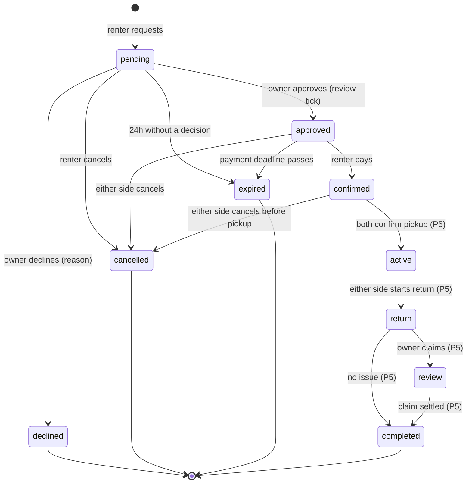

# Report draft: booking decision, payment, activity and the rental agreement (Phase 4)

Raw material for the final report. Sources: `docs/resources/TECHNICAL.md` (§5.1–5.4, §8.1, §10), `docs/resources/SPECS.md` (§4.1 steps 3–6, §4.4, §5.5–5.6), `lib/features/booking`, `lib/core/domain/services/booking_state_machine.dart`, `firestore.rules`. Rewrite in the team's own words before submission, and cite the references used.

Status note: the domain, data layer, blocs, screens and rules are implemented and covered by the tests listed in `TODO.md` 4.E. The rules were deployed to `veloce-1fe08`. The seeded end-to-end flow (owner approves, renter pays, contact unlocks, cancel refunds) still needs to be demonstrated on the device before the report is final.

## 1. Booking state machine

The transition table lives in `BookingStateMachine` and is mirrored by `validTransition()` in `firestore.rules`. A transition is legal only when both the old status, the new status and the actor match.



The owner can approve only after ticking "I reviewed their info". The repository checks the tick, the pending-review gate, the renter lock and the request state before writing.

## 2. Lazy expiry without Cloud Functions

The project runs on the Firebase Spark plan, so there is no scheduled backend function. Expiry is lazy:

- A pending request stores `expiresAt = createdAt + 24 h`.
- Approval stores `payDeadline = min(approval time + 24 h, pickup date)`.
- `ExpiryEngine` decides whether a booking is due. `BookingStateMachine.effectiveStatus()` also resolves expiry for display, so a list is correct even before a write lands.
- `ExpirySweeperCubit` runs at app start and on resume. `ActivityBloc` sweeps before it starts watching the list. Either party may persist the expiry because the rules allow `pending → expired` and `approved → expired` for both.
- Persisting an expiry updates the booking, deletes its calendar block, releases the renter lock when it belongs to this booking, writes an audit entry and notifies both parties.
- A renters' lock also gives other open requests the effective status `cancelled` (see below). The owner's client does not apply that lock to its list, so the owner can still attempt an approval and receive the clear "renter already booked" conflict.

## 3. One booking at a time and competing requests

Approval is one atomic batch containing:

1. `bookings/{id}`: `pending → approved` with `payDeadline`.
2. `renterLocks/{renterId}`: creates the lock. The rules allow creation only when no lock exists, the approving user owns the booking and the booking's new status is `approved`.
3. `calendarBlocks/{bookingId}`: copies the dates into the public calendar.
4. `bookings/{id}/private/owner`: writes the owner's phone, email and meeting point.
5. Every other pending request on the same car whose dates overlap: `pending → declined` with "The car has been booked for these dates." Each gets an audit entry and a notification.
6. The approved booking's audit entry and the renter notification.

A renter with a lock cannot be approved again. The repository reads the lock first for a clear message; the rules' `create`-only lock document is the final race guard. The renter's other open requests are not written by the owner (the owner cannot edit another owner's booking): the shared lock makes their effective status `cancelled`, which is what every renter list shows.

Calendar-overlap checks query `bookings` by `vehicleId`, `status = pending` and `startDate < target end`, then filter the end date and exact overlap in domain code. This uses the `vehicleId + status + startDate` index.

## 4. Payment, cancellation and the ledger

`PayBooking` validates the 9-digit MoMo number and the deadline, then calls `MomoGateway.charge`. The simulated gateway is behind the interface in `core`; swapping in the MTN API later changes the adapter only. A failed charge leaves the booking `approved`, so the payment screen can retry with the same details.

A successful charge is one batch:

- `bookings/{id}`: `approved → confirmed`.
- `transactions/{id}`: type `charge`, amount `totalPayable`, renter → Veloce, MoMo reference.
- audit entry and owner notification.

Contact documents are not rewritten by payment. The rules unlock the other party's `bookings/{id}/private/{side}` document when the booking status is `confirmed`, `active`, `return`, `review` or `completed`. Before that, the UI shows the locked tile and the repository never reads the document.

Cancellation is allowed until both sides confirm pickup. For a confirmed booking, `CancellationPolicy` refunds `rentalFee + cautionFee` (the full `totalPayable`); an approved or pending booking has no charge, so no refund row is written. The same batch deletes the calendar block, deletes the renter lock only when it points at this booking, writes the refund through `LedgerWriter`, audits the transition and notifies the other side.

The ledger invariant used throughout:

```
held(booking) = charge - release - refund - claim_deduction - late_fee >= 0
```

and it is zero once the booking is completed or cancelled. Phase 4 writes only `charge` and `refund`; Phase 5 adds release, platform fee, payout, claim deduction and late fee. Rules check the charge amount against `getAfter(booking).totalPayable` and the cancellation refund against the same total when the new status is `cancelled`.

## 5. Screens and state

| Screen | State owner | Main behaviour |
| --- | --- | --- |
| My Activity (renter/owner) | `ActivityBloc` | Open / Active / Past; owners grouped by car; quick actions for pay, cancel, review |
| Booking detail | `BookingDetailBloc` | Booking stream, effective status, six-step timeline, price rows, locked/revealed contact, P5/P6 slots |
| Owner request detail | `DecisionBloc` | Renter public profile, owner earnings, review tick gate, approve/decline with reason |
| Payment | `PaymentBloc` | MoMo form, countdown, processing, success reference, failure and retry |
| Payment result | none | Confirmation with booking and MoMo references |
| Rental agreement | `BookingDetailBloc` | Nine sections; renter acknowledgement |
| Owner home slots | `ActivityBloc` | Pending request count/list and upcoming rentals |

Screens read `BookingView`, which combines the booking, its effective status, the vehicle and both public profiles. Screens never query Firestore or compose lookups. No widget uses `setState`; local form controllers are disposed by a `StatefulWidget`, but business state is always in a bloc or cubit.

## 6. Security rules added in Phase 4

- `validTransition()` for `pending → approved/declined/cancelled/expired`, `approved → confirmed/cancelled/expired`, `confirmed → cancelled`, plus the same-status agreement acknowledgement. Field changes are restricted with `changed().hasOnly(...)` and server timestamps are required for `updatedAt`.
- Calendar blocks can be created only for an approved/confirmed booking and deleted only when the booking has become cancelled/expired/declined.
- Renter locks are create-only, require no existing lock, and require the approving user to own the booking; they are deleted only after the booking leaves the open state.
- `transactions` creation checks the type, parties, booking parties, amount and the booking status after the batch (`getAfter`).
- Contact documents keep the read rule that unlocks them only after payment; the owner may write their own contact side during approval.
- Notifications and audit logs stay create-only for the writer; the default deny rule remains.

## 7. Testing

Unit tests (pure domain): overlap detection, deadline calculation, cancellation refunds, effective status, the approve/decline/cancel/pay/agreement/expiry use cases. Bloc tests: Activity (classification, grouping, cancel), booking detail (locked vs revealed contact, actions), Decision (tick gate, approve, decline), Payment (success, failure, retry), ExpirySweeper (signed out, count, failure, re-entry). Widget tests: the contact tile switches from locked to revealed, and the booking detail has no overflow in landscape. The existing architecture test continues to enforce the layer and feature-import boundaries and the `setState` ban.

## 8. Still to add by hand

- Screenshots: owner decision, approval conflict, payment countdown, success, locked and unlocked contact, cancellation dialog.
- Live run: approve `booking-pending`, verify the overlapping request is declined in the console, pay `booking-approved`, confirm the `charge` row, cancel `booking-p4-confirmed-cancel`, rotate the phone.
- Demo segment D and the Figma-vs-app comparison.
