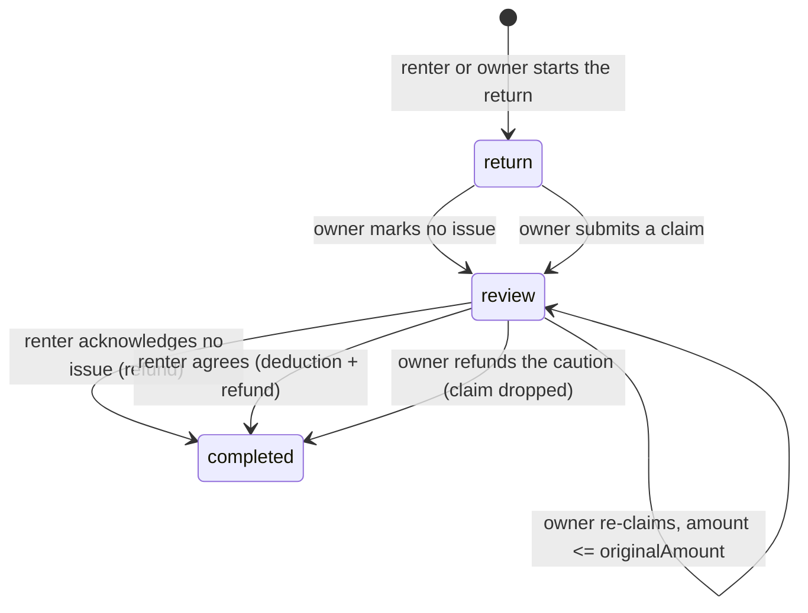

# Report draft: handover, return and caution settlement (Phase 5)

Raw material for the final report. Sources: `docs/resources/TECHNICAL.md` (§5.1–5.4, §10), `docs/resources/SPECS.md` (§4.1 steps 7–9, §6.5, §3 late fee), `docs/tasks/phase-5-handover-caution.md`, `lib/features/handover`, `lib/core/domain/services/ledger_balance.dart`, `firestore.rules`. Rewrite in the team's own words before submission, and cite the references used.

Status note: the screens, cubits, repository and rules for pickup, return, claims and settlement exist on branch `4-handover-return-caution-settlement`. See section 5 for exactly what was and was not verified. Numbers in the worked examples are computed by hand from the formulas below, not copied from a run of the app.

## 1. Escrow and ledger worked example

Veloce holds the money; it never reaches the owner before pickup. Every movement is one append-only row in `transactions` (type, from, to, amount). The invariant from Phase 4 still applies:

```
held(booking) = charge - release - refund - claim_deduction - late_fee >= 0
```

`platform_fee` and `payout` count as 0 in `LedgerBalance.held`: they are bookkeeping on money that `release` already moved out of escrow.

Example booking: `rentalFee` 200,000, `cautionFee` 100,000, `platformFee` 2,000, so `totalPayable` = 300,000.

| Step | Row (type, from to to, amount) | Held after |
| --- | --- | --- |
| Renter pays (Phase 4) | `charge`, renter to Veloce, 300,000 | 300,000 |
| Both confirm pickup (booking becomes `active`) | `release`, Veloce to owner, 200,000 | 100,000 |
| same batch | `platform_fee`, owner to Veloce, 2,000 | 100,000 |
| same batch | `payout`, Veloce to owner, 198,000 | 100,000 |

The owner nets 198,000 (200,000 minus 2,000); the 100,000 caution stays held. `PickupReleaseCalculator` computes the three amounts and `confirmPickup` writes the booking transition and all three rows in one batch, so the booking cannot become `active` without them.

The caution is then settled by one of these paths. Each is a single batch with the booking going to `completed`.

**A. No issue.** The owner marks no issue, the renter acknowledges. If the car came back on time:

| Row | Amount | Held after |
| --- | --- | --- |
| `refund`, Veloce to renter | 100,000 | 0 |

**B. Claim, renter agrees.** The owner claims 30,000 and the renter agrees:

| Row | Amount | Held after |
| --- | --- | --- |
| `claim_deduction`, Veloce to owner | 30,000 | 70,000 |
| `refund`, Veloce to renter | 70,000 | 0 |

The refund is `cautionFee - claim - lateFee`, so a claim of 30,000 gives 70,000. The platform fee is not charged again.

**C. Late return with a claim.** The car is 1 day late (late fee 60,000, see section 3) and the claim is 30,000. The fee cap leaves 70,000, so 60,000 stands:

| Row | Amount | Held after |
| --- | --- | --- |
| `claim_deduction`, Veloce to owner | 30,000 | 70,000 |
| `late_fee`, Veloce to owner | 60,000 | 10,000 |
| `refund`, Veloce to renter | 10,000 | 0 |

Zero-amount rows are not written (no `late_fee` row when the fee is waived or 0, no `refund` row when nothing is left).

Cross-check of the whole example, path C: renter paid 300,000; owner received 200,000 + 30,000 + 60,000 - 2,000 fee = 288,000; renter got back 10,000; Veloce kept 2,000. 288,000 + 10,000 + 2,000 = 300,000, so every franc is accounted for.

## 2. Claim flow

A claim lives in `cautionClaims/{bookingId}` with `originalAmount`, `currentAmount`, a reason, evidence photo URLs, `renterResponse` (`none`, `agreed`, `disputed`), a `status` (`open`, `settled`, `refunded`) and a `history` list that gets one entry per amount or response.



Steps:

1. **Marked no issue.** `markNoIssue` moves `return` to `review` with `cautionDecision` set. The renter then calls `acknowledgeNoIssue`, which completes the booking and writes the late fee (if any) and the refund.
2. **Claim submitted.** `submitClaim` (owner only, booking in `return`) needs an amount above 0 and no more than the caution, a reason and at least one evidence photo. It creates the claim with `originalAmount = currentAmount = amount` and moves the booking to `review`.
3. **Agree.** `respondToClaim` with `agreed` (renter only) settles in one batch: claim becomes `settled`, rows `claim_deduction`, `late_fee`, `refund` as in section 1, booking `completed`, `completedAt` stored.
4. **Dispute.** `respondToClaim` with `disputed` stores the response and a history entry and notifies the owner. No money moves and the booking stays in `review`.
5. **Re-claim.** `reviseClaim` (owner only, claim open and disputed) lowers the claim. The new amount must be at most `currentAmount`, at most `originalAmount` and at most the caution, so a claim can only shrink after a dispute. It resets `renterResponse` to `none` so the renter responds again.
6. **Refund.** `refundCaution` (owner, claim open) drops the claim: the claim becomes `refunded` and the caution, minus any late fee, goes back to the renter as a `refund`.

Repair costs (`repairExpenses`) are the owner's own record of what the repair cost. They are owner-only and they never create ledger rows; only the claim amount moves money, and it can never exceed the caution.

## 3. Late-fee formula

`LateFeeCalculator` (pure, in `lib/features/handover/domain/services`):

```
lateDays = ceil((returnedAt - endDate) / 24 h)         // 0 if not later than endDate
lateFee  = round(rentalFee * (1.3^lateDays - 1))       // compounding 30% a day
lateFee  = min(lateFee, cautionFee - claimAmount)      // cap
lateFee  = min(ownerAdjustedFee, lateFee)              // owner can only reduce
lateFee  = 0 when the owner waives it
```

Any part of a day counts as a full day (25 hours late is 2 days). The rental price compounds as `rentalFee * 1.3^days`; the late fee is the increase over the original rental fee. For a 100,000 rental:

| Days late | Rental with compounding | Late fee (increase) |
| --- | --- | --- |
| 1 | 130,000 | 30,000 |
| 2 | 169,000 | 69,000 |
| 3 | 219,700 | 119,700 |

The late fee is the increase (the right-hand column), which is what the code charges, the unit test asserts and the seed uses (a 120,000 rental gives 36,000 for 1 day). The task file and `TODO.md` were reworded to say so.

For the worked example (`rentalFee` 200,000, caution 100,000): 1 day late is 60,000; 2 days is 138,000 which the cap lowers to 100,000. With a 30,000 claim the cap is 70,000, so 60,000 stands for 1 day and 2 days becomes 70,000. The cap guarantees `lateFee + claim <= cautionFee`, so the refund is never negative (`respondToClaim` also fails with a validation error if it would be).

The owner can waive the fee (`lateFeeWaived`, stored on the booking) or set a lower `ownerAdjustedFee`; a higher value is ignored because the result is `min(adjusted, capped)`. Negative inputs and a claim above the caution throw `ArgumentError`. The return screen previews the fee before the renter confirms.

## 4. Security rules added in Phase 5

- `validTransition()` rows: `confirmed` to `confirmed` (first pickup confirmation), `confirmed` to `active` (needs both pickup timestamps), `active` to `return` (needs `returnedAt`), `return` to `return`/`review`, `review` to `review` (dispute and re-claim, `updatedAt` only), and `return`/`review` to `completed`, each limited with `changed().hasOnly(...)`.
- `transactions` creates: `release` equals `rentalFee`, `platform_fee` equals 2,000, `payout` equals `rentalFee - 2,000`, all only while the booking is `active` after the batch; `claim_deduction`, `late_fee` and caution `refund` are at most `cautionFee` and only when the booking is `completed`. Updates are denied, so the ledger is append-only.
- `cautionClaims`: owner-only create with `0 < amount <= cautionFee`, update by a party within the same bound, read by parties only, no delete.
- `repairExpenses`: only the booking's owner can read, create, update or delete.
- Tests: `tool/rules-test/firestore.rules.test.js` has 43 new cases for these rows.

## 5. Verification status

Run on 2026-11-20 on the development machine:

- **Firestore rules tests:** run against the local Firestore emulator (firebase-tools 15.34.2, Java 26, emulator jar 1.22.0, no login or real project). 51 tests, all passing.
  - The first run failed 3 tests, which found three problems in `firestore.rules`. All three are fixed:
    - The catch-all `match /{sub}/{docId}` under `bookings/{id}` also matched `private/{side}`, and rules are OR-ed, so a party could read and write the other side's contact document, including the owner reading the renter's contact before payment. It is now two matches by name, `checklistEntries` and `checklistMedia`. This hole came from the Phase 4 rules.
    - `confirmed` to `active` was accepted with only one pickup timestamp. It now needs both, and the first confirmation has its own `confirmed` to `confirmed` row.
    - Dispute and re-claim write only `updatedAt` to a booking that stays in `review`, which had no row. There is now a `review` to `review` row limited to `updatedAt`.
- **Not run in this draft:** `flutter test`, `flutter analyze` and `dart format` (owned by other work in the same branch), the seeded end-to-end flow on a device, and the Firebase deploy of the rules.
- The late-fee table in section 3 is covered by `test/features/handover/domain/services/late_fee_calculator_test.dart`; the worked-example amounts in section 1 were calculated by hand and are not asserted by a test.

## 6. Still to add by hand

- Screenshots: pickup checklist, release rows in the ledger, return screen with the late-fee preview, claim with evidence, renter dispute, settlement result.
- Live run with the seeded bookings from the task file: `booking-confirmed` pickup, `booking-p5-active-late`, the disputed and agreed claims, the waived late fee.
- Demo segment E and the Figma-vs-app comparison.
