# Veloce — Entity-Relationship Diagram

Based on **Veloce Specs v0.12**, section 9 (data model). The diagram is written in [Mermaid](https://mermaid.js.org/), which renders in GitHub, GitLab, Notion, Obsidian, VS Code (Markdown Preview Mermaid Support) and https://mermaid.live.

```mermaid
erDiagram
    USER ||--o| LICENCE : "renter has"
    USER ||--o| OWNER_IDENTITY : "owner has"
    USER ||--o| PAYOUT_METHOD : "owner has"
    USER ||--o{ VEHICLE : owns
    USER ||--o{ BOOKING : "rents (renter)"
    USER ||--o{ BOOKING : "receives (owner)"
    USER ||--o{ REVIEW : writes
    USER ||--o{ FAVOURITE : saves
    USER ||--o{ NOTIFICATION : receives

    VEHICLE ||--|| VEHICLE_DOCUMENTS : has
    VEHICLE ||--|{ VEHICLE_PHOTO : shows
    VEHICLE ||--o| AVAILABILITY_WINDOW : "available during"
    VEHICLE ||--o{ LONG_RENTAL_RATE : "discounts (max 3)"
    VEHICLE ||--o{ BOOKING : "is booked in"
    VEHICLE ||--o{ FAVOURITE : "saved as"
    VEHICLE ||--o{ REVIEW : "is reviewed in"

    BOOKING ||--o{ CHECKLIST_ENTRY : "has pickup/return items"
    BOOKING ||--o{ CHECKLIST_MEDIA : "has photos/videos"
    BOOKING ||--o{ TRANSACTION : "ledger entries"
    BOOKING ||--o| CAUTION_CLAIM : "may have"
    BOOKING ||--o{ REPAIR_EXPENSE : "may log"
    BOOKING ||--o{ REVIEW : "produces"
    BOOKING |o--o{ NOTIFICATION : "triggers"

    CAUTION_CLAIM ||--|{ CLAIM_HISTORY : "amount history"

    USER {
        string id PK
        string role "renter | owner"
        string name
        string email UK
        string auth_provider "password | google"
        string phone
        date date_of_birth "18+"
        boolean verified "simulated"
        datetime created_at
    }

    LICENCE {
        string user_id PK, FK
        string number
        date expiry
        string photo_url
        boolean active
    }

    OWNER_IDENTITY {
        string user_id PK, FK
        string national_id_number
        string photo_url
    }

    PAYOUT_METHOD {
        string user_id PK, FK
        string momo_number "MTN MoMo only"
    }

    VEHICLE {
        string id PK
        string owner_id FK
        string plate UK "RAB 123 A"
        string make
        string model
        int year "2005-2026"
        string type "Sedan | SUV | Hatchback | Minivan | Pickup"
        string transmission
        string fuel
        int seats
        string features "list"
        string description
        int daily_price_rwf "min 5000"
        int caution_fee_rwf "0 allowed"
        string neighbourhood
        string fuel_rule
        string smoking_policy
        string extras "list"
        string rules_file_url
        string video_url
        string status "published | paused"
    }

    VEHICLE_DOCUMENTS {
        string vehicle_id PK, FK
        string insurance_photo_url "required"
        string insurance_number
        date insurance_expiry
        string medical_photo_url "required"
        string medical_number
        date medical_expiry
        string yellow_paper_photo_url "optional"
        string yellow_paper_number
        date yellow_paper_expiry
    }

    VEHICLE_PHOTO {
        string id PK
        string vehicle_id FK
        string url
        int sort_order
        boolean is_primary
    }

    AVAILABILITY_WINDOW {
        string vehicle_id PK, FK
        date from_date
        date to_date
    }

    LONG_RENTAL_RATE {
        string id PK
        string vehicle_id FK
        int from_days "2 or more"
        int price_per_day_rwf "below base and lower tiers"
    }

    BOOKING {
        string id PK
        string reference UK "VLC-####"
        string vehicle_id FK
        string renter_id FK
        string owner_id FK
        date start_date
        date end_date
        int days
        int rental_fee_rwf
        int caution_fee_rwf
        int platform_fee_rwf "2000, owner side"
        int total_payable_rwf
        string status "pending | approved | confirmed | active | return | review | completed | declined | cancelled | expired"
        string decline_or_cancel_reason
        datetime pay_deadline
        datetime expires_at
        boolean agreement_acknowledged
        datetime owner_pickup_confirmed_at
        datetime renter_pickup_confirmed_at
        datetime owner_return_confirmed_at
        datetime renter_return_confirmed_at
        int late_fee_rwf
        datetime completed_at
    }

    CHECKLIST_ENTRY {
        string id PK
        string booking_id FK
        string kind "pickup | return"
        string side "owner | renter"
        string item
        boolean ticked
        datetime at
    }

    CHECKLIST_MEDIA {
        string id PK
        string booking_id FK
        string kind "pickup | return"
        string side "owner | renter"
        string media_type "photo | video"
        string url
    }

    TRANSACTION {
        string id PK
        string booking_id FK
        string type "charge | hold | release_to_owner | platform_fee | refund | claim_deduction | late_fee | payout"
        int amount_rwf
        string from_party
        string to_party
        string reference
        string status
        datetime at
    }

    CAUTION_CLAIM {
        string id PK
        string booking_id FK
        int amount_rwf "up to caution fee"
        string reason
        string evidence_urls "list"
        string renter_response "agree | not_agree | pending"
    }

    CLAIM_HISTORY {
        string id PK
        string claim_id FK
        int amount_rwf "never above original claim"
        string reason
        string evidence_urls "list"
        string renter_response
        datetime at
    }

    REPAIR_EXPENSE {
        string id PK
        string booking_id FK
        int amount_rwf
        string description
        string receipt_photo_url
        date logged_on
    }

    REVIEW {
        string id PK
        string booking_id FK
        string author_id FK
        string subject_user_id FK "null when reviewing a car"
        string subject_vehicle_id FK "null when reviewing a user"
        int stars
        string comment
        datetime created_at
        datetime edited_at
    }

    FAVOURITE {
        string user_id PK, FK
        string vehicle_id PK, FK
    }

    NOTIFICATION {
        string id PK
        string user_id FK
        string booking_id FK "optional"
        string type
        string title
        string text
        boolean read
        datetime created_at
    }
```

## Notes

- **Two links from BOOKING to USER**: `renter_id` and `owner_id` are both foreign keys to `USER`. A user has exactly one role per account, so a renter account only appears as `renter_id` and an owner account only as `owner_id`.
- **LONG_RENTAL_RATE** is stored as its own table (up to 3 rows per vehicle) instead of three repeating columns on `VEHICLE`. The spec lists it as a field of Vehicle; this is the normalised form. In Firestore it can equally be an array on the vehicle document.
- **CLAIM_HISTORY** holds the "history of amounts" from the spec: each re-claim (same or lower amount than the original) adds a row. `CAUTION_CLAIM` holds the current state.
- **REVIEW** has two nullable subject keys; exactly one is set. A completed booking produces up to three reviews: owner → renter, renter → owner, renter → car.
- **TRANSACTION** is the escrow ledger. Money held = paid in − released − refunded. Finances (total earned, total losses) are computed from this table and `REPAIR_EXPENSE`.
- **Contact details** (phone, email, exact meeting point) live on `USER` / `VEHICLE` but are exposed to the other party only once the booking is `confirmed` or later (enforced through a private document and security rules, spec section 11).
- **Not in the database**: the list of accounts linked on a device for account switching (spec 8.2) is stored on the device only.
- In Firestore these tables map to collections and sub-collections (for example `bookings/{id}/checklist`), but the logical model above is the same.
