# Veloce — Technical Document

**Version:** 1.0 · **Date:** 2026-11-08 · **Source:** `veloce-spec-v0.12.md` + the course assignment brief (requirements and rubric)
**Audience:** the 6-person team. Read sections 1–4 before writing any code; the rest is reference.

This document turns the product spec into an implementable design that satisfies every requirement and rubric line of the assignment. `phases.md` is derived from it. Where this document and the spec disagree on *behaviour*, the spec wins; where they disagree on *technology*, this document wins (the spec assumed Cloud Functions and Firebase Storage; see D-1 and D-2).

---

## 1. Scope, constraints and decisions

### 1.1 Hard constraints from the assignment

| # | Constraint | Where handled |
| --- | --- | --- |
| C1 | Mobile only. Web/desktop/Chrome builds score **zero**. | §2.3 (create project with `--platforms=android,ios` only; delete other platform folders) |
| C2 | No `setState()` as state management. | §3.3 (BLoC/Cubit everywhere; `setState` banned in CI grep) |
| C3 | Clean Architecture; nothing dumped in `lib/`. | §3.1–3.2 |
| C4 | ERD before backend, and it must match Firestore exactly. | §4 |
| C5 | CRUD wired to the UI; ≥2 auth methods; security rules. | §4.6, §6, §8 |
| C6 | ≥1 widget test + ≥1 unit test (rubric top band: ≥3 unit tests, coverage ≥70%). | §13 |
| C7 | `dart format` clean; `flutter analyze` = 0 issues. | §14 |
| C8 | Runs on a physical device or emulator; demo uses the **release APK on a physical phone**. | §2.3, §16.2 |
| C9 | GitHub collaboration, equal contribution, PR reviews. | §15 |
| C10 | Report (PDF), demo video (10–15 min), Group Contribution Tracker. Missing tracker = **not graded**. | §16 |

### 1.2 Decisions (flag any you disagree with before Phase 0 ends)

| ID | Decision | Why |
| --- | --- | --- |
| **D-1** | **No Cloud Functions.** All booking and money transitions run as client-side Firestore **transactions/batched writes**, guarded by Firestore security rules (§5, §8). Time-based expiry is **lazy** (evaluated and persisted when either party opens the app). | Cloud Functions need the paid Blaze plan; the team uses the free Spark plan. The spec's "client must never change money/status" is relaxed to "client may only make *valid* transitions, enforced by rules". The `BookingRepository` interface is the seam: swapping in Cloud Functions later changes the data layer only. |
| **D-2** | **Supabase Storage** (not Firebase Storage) for all files. Firebase Auth stays the identity provider. | Your instruction; Firebase Storage also needs Blaze. |
| **D-3** | Sensitive files (National ID, licence, vehicle papers) go in a Supabase bucket under **unguessable UUID paths**; the URL is stored only in owner-only Firestore documents. | Supabase private buckets need Supabase-recognised auth; Firebase users are not Supabase users. Listed in Known Limitations (§17). |
| **D-4** | State management: **flutter_bloc** (BLoC for flows with events, Cubit for simple state). | Predictable, testable (`bloc_test`), matches the course tutorial folder structure (§3.2). |
| **D-5** | Routing: **go_router** with role-based shells and a redirect guard. | Declarative routes, deep links from notifications, easy auth redirect. |
| **D-6** | Simulation seams (`MomoGateway`, `VerificationProvider`) are interfaces with simulated implementations. | Spec §11. |
| **D-7** | Account switching keeps each linked account's credentials in `flutter_secure_storage` and re-signs in on switch (spike alternative in §6.4). | Firebase Auth holds one user per app instance. |

### 1.3 Not in scope
Everything in spec §12 (admin panel, chat, push/SMS/email, cards/banks/Airtel, other cities/languages, extensions, arbitration).

---

## 2. Technology stack

### 2.1 Services

| Concern | Choice |
| --- | --- |
| Auth | Firebase Authentication: email/password (+ email verification, password reset) and Google Sign-In |
| Database | Cloud Firestore (default `(default)` database, `africa-south1` or nearest region) |
| File storage | Supabase Storage (buckets in §7) |
| Local prefs | `shared_preferences` (§9) |
| Local secrets | `flutter_secure_storage` (linked accounts) |
| Hosting/CI | GitHub + GitHub Actions |

### 2.2 Packages (pin exact versions in `pubspec.yaml` at Phase 0; use latest stable compatible set)

| Purpose | Package |
| --- | --- |
| State management | `flutter_bloc`, `bloc`, `equatable` |
| DI | `get_it` |
| Routing | `go_router` |
| Firebase | `firebase_core`, `firebase_auth`, `cloud_firestore`, `google_sign_in` |
| Supabase | `supabase_flutter` (storage only) |
| Prefs / secrets | `shared_preferences`, `flutter_secure_storage` |
| Media | `image_picker`, `video_player`, `cached_network_image` |
| Charts | `fl_chart` (Finances) |
| Utilities | `intl`, `uuid`, `url_launcher`, `collection` |
| Lints | `flutter_lints` |
| Tests | `flutter_test`, `bloc_test`, `mocktail`, `fake_cloud_firestore`, `firebase_auth_mocks` |

### 2.3 Project creation (do exactly this)

```bash
flutter create --platforms=android,ios --org rw.veloce --project-name veloce veloce
# confirm there is no web/, windows/, linux/, macos/ folder; never run `flutter run -d chrome`
```

- Android: `minSdk` per Firebase requirement; package `rw.veloce.veloce`.
- **Google Sign-In needs SHA-1 and SHA-256 fingerprints registered in Firebase for every machine that builds a debug APK, and for the release keystore.** Collect all 6 debug fingerprints in Phase 0, plus the release one (otherwise Google login fails only in the release APK used for the demo).
- Release signing: one team keystore (not committed; shared privately), `key.properties` git-ignored.
- Config for reviewers: `firebase_options.dart` and `google-services.json` are committed (Firebase client config is public by design and protected by rules). Supabase URL and anon key go in `env.json` (git-ignored; `env.example.json` committed); the real `env.json` is included in the submission zip. Run with `flutter run --dart-define-from-file=env.json`.

---

## 3. Architecture

### 3.1 Clean Architecture layers

```
presentation  →  domain  ←  data
(pages, widgets,  (entities,   (models/DTOs, datasources,
 bloc/cubit)       use cases,   repository implementations)
                   repository
                   interfaces)
```

Rules:
1. `domain` is pure Dart (no Flutter, no Firebase imports). Entities, repository **interfaces**, use cases.
2. `data` implements the interfaces with Firestore/Supabase; models map `Map<String,dynamic>` ⇄ entities.
3. `presentation` talks only to use cases/repository interfaces through blocs. **No business logic in widgets.**
4. Dependencies are injected with `get_it`; blocs are created in route-level `BlocProvider`s (not global singletons) so they are disposed on navigation and on sign-out.
5. Repositories return `Result<T>` (`Success`/`Failure(AppFailure)`), never throw to the UI.

### 3.2 Folder structure (matches the BLoC tutorial layout, feature-first)

```
lib/
  main.dart                      # init Firebase, Supabase, DI, runApp only
  app/
    app.dart                     # MaterialApp.router, theme, BlocProviders (Auth, Theme)
    router/
      app_router.dart            # composes the per-feature route lists
      route_names.dart           # every path constant
    di/
      injection_container.dart   # calls each feature's registerXxx()
  core/
    config/        env.dart
    constants/     firestore_paths.dart, firestore_fields.dart, app_constants.dart
    domain/
      entities/    user_account.dart, vehicle.dart, booking.dart, ... (shared, §4)
      enums/       booking_status.dart, user_role.dart, ...
      services/    pricing_calculator.dart, booking_state_machine.dart, clock.dart
    error/         app_failure.dart, result.dart
    data/
      models/      *_model.dart (fromMap/toMap for every shared entity)
      services/    media_storage.dart (Supabase), ledger_writer.dart, audit_logger.dart,
                   notification_writer.dart, momo_gateway_sim.dart, verification_sim.dart,
                   preferences_service.dart
    theme/         app_theme.dart, app_colors.dart, app_text_styles.dart
    utils/         validators.dart, formatters.dart, responsive.dart
    widgets/       shared UI kit (§12.4)
  features/
    auth/          profile/        vehicles/      discovery/
    booking/       handover/       finances/      reviews/
    notifications/
      <feature>/
        data/         datasources/, models/, repositories/
        domain/       entities/, repositories/, usecases/
        presentation/ bloc/, pages/, widgets/
        <feature>_injection.dart   # registers this feature in get_it
        <feature>_routes.dart      # this feature's GoRoute list
test/                            # mirrors lib/ (unit, bloc, widget)
integration_test/                # optional
tool/seed/                       # Admin SDK seed script (Node)
```

**Merge-conflict rule:** each feature owns its own `*_injection.dart` and `*_routes.dart`, so two people never edit the same shared file. Phase 0 creates all of them (with placeholder pages) up front.

### 3.3 State management (why BLoC is appropriate — for the presentation Q&A)

- The app is event-driven (approve, pay, confirm pickup, claim, review) with many *states per flow* (loading, success, failure, awaiting-other-party). BLoC's explicit event → state mapping makes each transition testable and keeps rules out of the UI.
- Firestore streams plug directly into blocs (`emit.forEach` / `StreamSubscription`), so the UI updates instantly after a write (rubric: "UI updates instantly").
- Cubit for simple screens (theme, filters, favourites toggle); Bloc for multi-step flows (auth, listing wizard, booking actions).
- Conventions: `Equatable` events/states; one `*_event.dart`, `*_state.dart`, `*_bloc.dart` per bloc; state classes carry `status` + `data` + `error`; widgets use `BlocBuilder`/`BlocListener` (`BlocSelector` where only one field matters). **`setState` is forbidden** (CI step fails on `grep -rn "setState(" lib/`; `StatefulWidget` only for controllers/animations that need `dispose`, never for app state).
- Auth state is a global `AuthBloc` (above the router); on sign-out it emits `Unauthenticated`, all route-level blocs are disposed, and local caches (lookup cache, selected filters in memory) are cleared — this is the "sign-out clears state" rubric item.

### 3.4 Error handling and feedback
`AppFailure` subtypes: `NetworkFailure`, `PermissionFailure` (rules rejected), `ValidationFailure`, `ConflictFailure` (e.g. dates taken, renter already booked), `NotFoundFailure`, `UnknownFailure`. A global `AppMessenger` shows SnackBars: failures in the error colour with a plain-English message, successes briefly. Every bloc listener maps `Failure` → `AppMessenger.error(...)`; no raw exception text is shown to users.

---

## 4. Data design

### 4.1 Firestore ⇄ ERD mapping (the ERD below *is* this table)

| ERD entity | Firestore path | Written by (phase) | Read by |
| --- | --- | --- | --- |
| USER | `users/{uid}` | P1 | everyone (public profile info only) |
| CONTACT | `users/{uid}/private/contact` | P1 | owner of the doc only |
| LICENCE | `users/{uid}/private/licence` | P1 | owner of the doc only |
| OWNER_IDENTITY | `users/{uid}/private/identity` | P1 | owner of the doc only |
| PAYOUT_METHOD | `users/{uid}/private/payout` | P1 | owner of the doc only |
| FAVOURITE | `users/{uid}/favourites/{vehicleId}` | P3 | that user |
| VEHICLE (+ AvailabilityWindow embedded as `availableFrom`/`availableTo`) | `vehicles/{vehicleId}` | P2 | everyone signed in |
| VEHICLE_PHOTO | `vehicles/{vid}/photos/{photoId}` | P2 | everyone signed in |
| VEHICLE_DOCUMENT | `vehicles/{vid}/documents/{insurance|medical|yellowPaper}` | P2 | vehicle owner only |
| BOOKING | `bookings/{bookingId}` | P3 create; P4/P5 update | the two parties |
| BOOKING_CONTACT | `bookings/{id}/private/{renter|owner}` | renter writes `renter`, owner writes `owner` | other party only when status ∈ {confirmed, active, return, review} |
| CALENDAR_BLOCK | `calendarBlocks/{bookingId}` | P4 | everyone signed in (search needs it) |
| RENTER_LOCK | `renterLocks/{renterId}` | P4 (owner approves), P4/P5 release | signed-in (read), see §5.4 |
| CHECKLIST_ENTRY | `bookings/{id}/checklistEntries/{kind_side_item}` | P5 | the two parties |
| CHECKLIST_MEDIA | `bookings/{id}/checklistMedia/{mediaId}` | P5 | the two parties |
| TRANSACTION | `transactions/{txId}` | P4, P5 via `LedgerWriter` (create-only) | the two parties |
| CAUTION_CLAIM | `cautionClaims/{bookingId}` | P5 | the two parties |
| REPAIR_EXPENSE | `repairExpenses/{id}` | P5 | the vehicle's owner |
| REVIEW | `reviews/{bookingId_authorId_subjectType}` | P6 | everyone signed in (public) |
| NOTIFICATION | `notifications/{id}` | any phase via `NotificationWriter`; P6 reads | recipient only |
| AUDIT_LOG | `auditLogs/{id}` | `AuditLogger` (create-only) | nobody in-app (console only) |

### 4.2 Entity-relationship diagram

```mermaid
erDiagram
  USER ||--o| CONTACT : "private details"
  USER ||--o| LICENCE : "renter has"
  USER ||--o| OWNER_IDENTITY : "owner has"
  USER ||--o| PAYOUT_METHOD : "owner has"
  USER ||--o{ VEHICLE : owns
  VEHICLE ||--|{ VEHICLE_PHOTO : has
  VEHICLE ||--o{ VEHICLE_DOCUMENT : has
  USER ||--o{ FAVOURITE : saves
  VEHICLE ||--o{ FAVOURITE : "saved as"
  USER ||--o{ BOOKING : "requests as renter"
  USER ||--o{ BOOKING : "receives as owner"
  VEHICLE ||--o{ BOOKING : "is booked in"
  BOOKING ||--o{ BOOKING_CONTACT : "unlocks (renter, owner)"
  BOOKING ||--o| CALENDAR_BLOCK : blocks
  USER ||--o| RENTER_LOCK : "holds"
  BOOKING ||--o| RENTER_LOCK : "is the lock of"
  BOOKING ||--o{ CHECKLIST_ENTRY : has
  BOOKING ||--o{ CHECKLIST_MEDIA : has
  BOOKING ||--o{ TRANSACTION : records
  BOOKING ||--o| CAUTION_CLAIM : "may have"
  BOOKING ||--o{ REPAIR_EXPENSE : "may have"
  BOOKING ||--o{ REVIEW : "is reviewed by"
  USER ||--o{ REVIEW : writes
  USER ||--o{ NOTIFICATION : receives
  BOOKING ||--o{ AUDIT_LOG : logs

  USER {
    string id PK "= Firebase Auth uid"
    string role "renter | owner"
    string name
    string photoUrl
    bool verified
    double ratingAvg "aggregate"
    int ratingCount "aggregate"
    int completedCount "aggregate"
    timestamp createdAt
  }
  CONTACT {
    string userId PK "FK USER.id"
    string email
    string phone
    timestamp dateOfBirth
    string authProvider "password | google"
  }
  LICENCE {
    string userId PK "FK USER.id"
    string number
    timestamp expiry
    string photoUrl
    bool active
  }
  OWNER_IDENTITY {
    string userId PK "FK USER.id"
    string nationalIdNumber "16 digits"
    string photoUrl
  }
  PAYOUT_METHOD {
    string userId PK "FK USER.id"
    string momoNumber "MTN MoMo"
  }
  VEHICLE {
    string id PK
    string ownerId FK
    string plate "RAB 123 A"
    string make
    string model
    int year
    string type "Sedan|SUV|Hatchback|Minivan|Pickup"
    string transmission
    string fuel
    int seats
    array features
    string description
    int dailyPrice "RWF"
    array longRates "max 3 of {fromDays, pricePerDay}"
    int cautionFee "RWF"
    string neighbourhood
    string fuelRule
    string smoking
    array extras
    string rulesFileUrl
    string videoUrl
    string status "published | paused"
    timestamp availableFrom
    timestamp availableTo
    timestamp docsValidUntil "derived: min(insurance, medical expiry)"
    double ratingAvg "aggregate"
    int ratingCount "aggregate"
    timestamp createdAt
  }
  VEHICLE_PHOTO {
    string id PK
    string vehicleId FK
    string url
    int order
    bool isPrimary
  }
  VEHICLE_DOCUMENT {
    string kind PK "insurance | medical | yellowPaper"
    string vehicleId FK
    string number
    timestamp expiry
    string photoUrl
    bool verified
  }
  FAVOURITE {
    string vehicleId PK "FK VEHICLE.id"
    string userId FK
    timestamp createdAt
  }
  BOOKING {
    string id PK
    string reference "VLC-####"
    string vehicleId FK
    string renterId FK
    string ownerId FK
    timestamp startDate
    timestamp endDate
    int days "end - start; return day not charged"
    int dailyRateApplied "locked at request"
    int rentalFee
    int cautionFee
    int platformFee "2000, paid by owner"
    int totalPayable "rentalFee + cautionFee"
    string status "see 5.1"
    string reason "decline or cancel reason"
    timestamp payDeadline
    timestamp expiresAt "pending expiry"
    timestamp agreementAckAt
    timestamp ownerPickupConfirmedAt
    timestamp renterPickupConfirmedAt
    timestamp returnedAt
    timestamp ownerReturnConfirmedAt
    timestamp renterReturnConfirmedAt
    int lateDays
    int lateFee
    bool lateFeeWaived
    string cautionDecision "null | no_issue | claim"
    timestamp renterOutcomeAckAt
    timestamp completedAt
    timestamp createdAt
    timestamp updatedAt
  }
  BOOKING_CONTACT {
    string side PK "renter | owner"
    string bookingId FK
    string phone
    string email
    string meetingPoint "owner side only"
  }
  CALENDAR_BLOCK {
    string bookingId PK "FK BOOKING.id"
    string vehicleId FK
    timestamp startDate
    timestamp endDate
  }
  RENTER_LOCK {
    string renterId PK "FK USER.id"
    string bookingId FK
    timestamp createdAt
  }
  CHECKLIST_ENTRY {
    string id PK "kind_side_item"
    string bookingId FK
    string kind "pickup | return"
    string side "owner | renter"
    string item
    bool ticked
    timestamp at
  }
  CHECKLIST_MEDIA {
    string id PK
    string bookingId FK
    string kind "pickup | return"
    string side "owner | renter"
    string mediaType "photo | video"
    string url
    timestamp at
  }
  TRANSACTION {
    string id PK
    string bookingId FK
    string vehicleId FK
    string ownerId FK
    string renterId FK
    string type "charge|release|platform_fee|refund|claim_deduction|late_fee|payout"
    int amount "RWF"
    string fromParty "renter|veloce|owner"
    string toParty "renter|veloce|owner"
    string reference "MoMo ref"
    string status "success | failed"
    timestamp at
  }
  CAUTION_CLAIM {
    string bookingId PK "FK BOOKING.id"
    int originalAmount "ceiling for re-claims"
    int currentAmount
    string reason
    array evidenceUrls
    string renterResponse "none | agreed | disputed"
    array history "amount, reason, at, response"
    string status "open | settled | refunded"
    timestamp updatedAt
  }
  REPAIR_EXPENSE {
    string id PK
    string bookingId FK
    string vehicleId FK
    string ownerId FK
    int amount
    string description
    string receiptUrl
    timestamp createdAt
  }
  REVIEW {
    string id PK "bookingId_authorId_subjectType"
    string bookingId FK
    string authorId FK
    string subjectType "user | vehicle"
    string subjectId "FK USER.id or VEHICLE.id"
    int stars "1-5"
    string comment
    timestamp createdAt
    timestamp editedAt
  }
  NOTIFICATION {
    string id PK
    string userId FK
    string type
    string title
    string text
    string bookingId FK
    bool read
    timestamp createdAt
  }
  AUDIT_LOG {
    string id PK
    string actorId FK
    string entityType
    string entityId
    string oldState
    string newState
    timestamp at
  }
```



Export the diagram as PNG/SVG for the report. **Field names in code (`core/constants/firestore_fields.dart`) must equal the names above.** Any change = PR that updates this ERD, the constants, the models and the seed script, reviewed by all six.

### 4.3 Denormalisation register (every intentional duplicate, with a reason)
The rubric asks for "no duplicated data"; these are the only exceptions, each needed for access control or query support:

| Duplicate | Why it must exist |
| --- | --- |
| `ratingAvg/ratingCount/completedCount` on USER, `ratingAvg/ratingCount` on VEHICLE | Cards and profiles need them without scanning all reviews. Updated in the same batch as the review write. |
| `VEHICLE.docsValidUntil` | Renters cannot read private vehicle documents but search must hide cars with expired insurance/medical certificate. Recomputed whenever documents change. |
| `BOOKING_CONTACT` (copy of phone/email) | Rules cannot join; phone/email live in a doc the other party may read only after payment. |
| `CALENDAR_BLOCK` | Renters cannot read other renters' bookings, yet search must exclude blocked dates. |
| `TRANSACTION.ownerId/renterId/vehicleId` | Finances and payment history query by user/vehicle without joining bookings; rules check parties without extra reads. |

Names and photos of users/vehicles are **not** copied into bookings. Lists resolve them through a cached lookup (`UserLookup`, `VehicleLookup` in `core`).

### 4.4 Indexes (`firestore.indexes.json`, Phase 0 creates; owners add as they hit "requires index" errors)

| Collection | Fields | Used for |
| --- | --- | --- |
| `vehicles` | `status` ↑, `neighbourhood` ↑, `dailyPrice` ↑ | Search by area, sort by price |
| `vehicles` | `status` ↑, `docsValidUntil` ↓ | Hide cars with expired papers |
| `vehicles` | `ownerId` ↑, `createdAt` ↓ | My cars |
| `bookings` | `renterId` ↑, `createdAt` ↓ | Renter My Activity |
| `bookings` | `ownerId` ↑, `createdAt` ↓ | Owner My Activity |
| `bookings` | `vehicleId` ↑, `status` ↑, `startDate` ↑ | Overlap checks on approval |
| `calendarBlocks` | `vehicleId` ↑, `endDate` ↑ | Search availability |
| `transactions` | `ownerId` ↑, `at` ↓ | Finances |
| `transactions` | `ownerId` ↑, `vehicleId` ↑, `at` ↓ | Per-car finances |
| `transactions` | `renterId` ↑, `at` ↓ | Renter payment history |
| `repairExpenses` | `ownerId` ↑, `createdAt` ↓ | Finances losses |
| `reviews` | `subjectId` ↑, `createdAt` ↓ | Reviews list |
| `notifications` | `userId` ↑, `createdAt` ↓ | Notification list |

### 4.5 Search algorithm (P3)
1. Query `vehicles`: `status == published`, optional `neighbourhood`, `docsValidUntil >= today`; type/transmission/seats/price filtered client-side (Firestore allows one range field).
2. Keep cars whose `[availableFrom, availableTo]` contains the whole requested range.
3. For remaining cars, read `calendarBlocks` where `vehicleId == car.id && endDate > requestedStart`, drop any with `startDate < requestedEnd`.
4. Never show the viewer's own cars to themselves in results.

### 4.6 CRUD coverage matrix (every entity has a UI path for each applicable operation)

| Entity | Create | Read | Update | Delete |
| --- | --- | --- | --- | --- |
| User/profile | Register | Profile, public profile | Edit profile, payout, licence | Remove linked account from device (account itself untouched) |
| Vehicle | 7-step wizard | Cars list, detail | Edit, pause/resume, availability, documents | Remove car |
| Vehicle photo | Wizard | Carousel | Reorder / set primary | Remove photo |
| Favourite | Tap heart | Saved tab | n/a | Un-heart |
| Booking | Request | Activity, detail | Approve, pay, pickup, return… | Cancel / decline (status), see note |
| Checklist | Tick + upload | Detail | Re-tick, replace photo | Remove media before confirming |
| Claim | Owner claims | Both parties | Re-claim lower/same | Refund (closes) |
| Repair expense | Log cost | Finances | Edit | Delete entry |
| Review | Write | Lists | Edit | **Not allowed (spec)** |
| Notification | System | Notifications tab | Mark read | Clear / delete one |

*Note:* bookings use soft deletion (terminal statuses) because the ledger must stay auditable; the demo's "Delete" shown against Firestore uses car, favourite, photo, repair expense and notification deletes.

---

## 5. Booking and money logic (client-side, rule-guarded)

### 5.1 Pure domain logic (Phase 0, unit-tested)

**State machine** (`BookingStateMachine.canTransition(from, to, actor)`), statuses from spec §4.2:

| From → To | Actor | Written by |
| --- | --- | --- |
| `pending → approved` | owner (after "reviewed info" tick) | P4 |
| `pending → declined` | owner (reason) or owner's auto-decline of overlapping requests | P4 |
| `pending → cancelled` | renter, or auto (renter has another approved booking) | P4 |
| `pending → expired` | either party's client after `expiresAt` | P4 |
| `approved → confirmed` | renter (payment succeeded) | P4 |
| `approved → cancelled` | either | P4 |
| `approved → expired` | either party's client after `payDeadline` | P4 |
| `confirmed → active` | whichever party confirms pickup **second** | P5 |
| `confirmed → cancelled` | either (full refund) | P4 |
| `active → return` | either side starts return | P5 |
| `return → review` | owner claims an amount | P5 |
| `return → completed` | both confirmed return + no issue acknowledged | P5 |
| `review → completed` | renter agrees, or owner refunds | P5 |

Everything else is rejected both in the state machine and in the rules.

**Pricing** (`PricingCalculator`, used by P2 preview, P3 request, P4 payment):
- `days = endDate − startDate` (return day not charged), minimum 1.
- `dailyRateApplied` = `pricePerDay` of the tier with the largest `fromDays ≤ days`, else `dailyPrice`. The chosen rate applies to **every** day.
- `rentalFee = days × dailyRateApplied`; `platformFee = 2000` (owner side); `totalPayable = rentalFee + cautionFee`; owner receives `rentalFee − 2000`.
- Tier validation: ≤3 tiers; `fromDays ≥ 2`; each price `< dailyPrice` and `<` the previous tier's price; each `≥ 5000`.
- Rate and totals are written into the booking at request time and never recomputed.

**Late fee** (`LateFeeCalculator`, P5): `lateDays = ceil(hoursLate / 24)`; `totalWithLate = rentalFee × 1.3^lateDays`; `lateFee = round(totalWithLate − rentalFee)` (100,000 → 130,000 → 169,000 → 219,700). Owner may waive/reduce. Always `lateFee + claimAmount ≤ cautionFee`.

### 5.2 Ledger (escrow as bookkeeping)

| Type | From → To | Written when |
| --- | --- | --- |
| `charge` | renter → veloce | Payment succeeds (`totalPayable`) |
| `release` | veloce → owner | Both confirm pickup (`rentalFee`) |
| `platform_fee` | owner → veloce | Same moment (`2000`) |
| `payout` | veloce → owner MoMo | Same moment (`rentalFee − 2000`, simulated) |
| `refund` | veloce → renter | Cancel (everything), safe return (`cautionFee`), or claim remainder |
| `claim_deduction` | veloce → owner | Claim agreed (amount) |
| `late_fee` | veloce → owner | Settled out of caution |

Invariant (unit-tested, shown in report): `held(booking) = charge − release − refund − claim_deduction − late_fee ≥ 0`, and `0` once `completed`/`cancelled`.
Finances (P6): **Earned** = Σ(`release` − `platform_fee`) + Σ`late_fee`; **Loss** per booking = max(0, repairExpense − claim_deduction received); Earned dated by ledger `at`, Loss by repair-cost `createdAt`. The transaction table total equals the two tiles.

### 5.3 Atomicity and audit
Each transition is **one** Firestore transaction/batch containing: booking update, ledger entries, calendar block/lock changes, notification(s), and an `AuditLog` entry (actor, entity, old → new state). Security rules verify the batch with `getAfter()` so the client cannot, for example, mark a booking `active` without both confirmations or write a `release` entry for the wrong amount.

### 5.4 Cross-user effects without Cloud Functions

| Spec rule | Mechanism |
| --- | --- |
| Approving declines the car's other **overlapping** pending requests | Same owner → the approving client writes `declined` on those bookings in the same batch. |
| Approving cancels **all of the renter's other open requests** | Owner cannot edit another owner's booking. Instead the approve batch creates `renterLocks/{renterId}` = this booking (rules: only if no active lock exists). Any other `pending/approved` booking of that renter has *effective status* `cancelled` (resolved in `BookingStateMachine.effectiveStatus`); the renter's client persists it on next open, and the second owner's approve attempt fails with `ConflictFailure("Renter already booked")`. |
| One booking at a time | The same lock: a renter with a lock cannot send new requests. Lock released on cancel/decline/expire, and when the rental enters `return`. |
| 24 h pending expiry / payment deadline | Lazy: `ExpirySweeper` runs on app start/resume and on activity-list load for the signed-in user; either party may persist `expired` and free the block/lock. |
| Hide contact until payment | Contact docs readable by the other party only when `status ∈ {confirmed, active, return, review}` (rules). |
| Pending review blocks requests/approvals | `PendingReviewChecker` (interface in P0, implemented by P6) is called by the request and approve use cases. |
| Expired insurance/medical pauses a car | `docsValidUntil` filter in search + owner list shows "Paused – document expired". |

---

## 6. Authentication (P1)

### 6.1 Methods and flows
1. **Email + password**: register (role → details → verification → welcome), login, logout, **password reset** page (`sendPasswordResetEmail`), **email verification** (`sendEmailVerification`; unverified users can browse; requesting, publishing a car and paying require a verified email).
2. **Google Sign-In**: first sign-in continues to role choice and the document steps (spec §11); returning users go straight to their Home. Google users are email-verified by default.
3. **Simulated OTP / identity verification** (via `VerificationProvider`): after details, a 6-digit code screen (code is generated and shown in a SnackBar for the demo; wrong code shows an error, with a "fail" mode for the retry state in spec §5.1).

### 6.2 Security practices (rubric: "security best practices")
Client-side validation on every field (§12.3), password ≥ 8 chars with a letter and a digit, specific error messages mapped from `FirebaseAuthException` codes (`wrong-password`, `user-not-found`, `email-already-in-use`, `too-many-requests`, …), no blank submits, email verification, OTP step, rules-enforced roles (role is immutable after creation), session persisted by Firebase Auth (restart keeps the user) and re-validated at splash.

### 6.3 Routing guard
`AuthBloc` states: `Unknown → Unauthenticated | Authenticated(user, role)`. `GoRouter.redirect` sends unauthenticated users to `/welcome`, authenticated users away from auth pages, and each role only into its own shell.

### 6.4 Account switcher (spec §8.2)
- Linked accounts list (uid, email, name, role, auth type) in `flutter_secure_storage`.
- Email/password accounts: store credential, re-sign-in on switch. Google accounts: `GoogleSignIn` silent/lightweight re-auth; if that needs interaction, fall back to the Google chooser (spec allows re-prompt when a session expired).
- On switch: `AuthBloc` signs out the current user without clearing linked list, signs in the target, resets all route-level blocs, navigates to the role's Home.
- **Spike alternative** (P1 owner to try for half a day): a secondary `FirebaseApp` per linked account keeps separate persisted sessions with no re-auth, at the cost of injecting the active app's `FirebaseFirestore`/`FirebaseAuth` into all datasources.

---

## 7. File storage — Supabase (P0 sets up, everyone uploads through `MediaStorage`)

| Bucket | Content | Access |
| --- | --- | --- |
| `car-media` | Car photos/videos, rules PDF | public read |
| `user-docs` | National ID, licence, vehicle papers, profile photos | stored under `uuid/uuid.ext`; URL only in owner-only Firestore docs (D-3) |
| `checklist-media` | Pickup/return photos & videos, claim evidence | UUID paths; URL only in party-only docs |
| `receipts` | Repair receipts | UUID paths; owner-only docs |

- Policies: anon role may `INSERT` and `SELECT` on these buckets only; **bucket-level limits** (images ≤ 5 MB, videos ≤ 50 MB, MIME allow-list) are the abuse control; no `UPDATE/DELETE` for anon (replacing a file = upload a new UUID path).
- `MediaStorage.upload(File, bucket) → Result<String url>`, `.delete(url)`. Compress images (`image_picker` `imageQuality: 80`, max 1600 px) before upload.
- Upgrade path: Supabase third-party Firebase auth + RLS (requires a `role` custom claim on Firebase tokens, which needs a backend) — documented under Future Work.

---

## 8. Security rules

### 8.1 Firestore rules skeleton (Phase 0 commits; each phase fills its own labelled block)

```
rules_version = '2';
service cloud.firestore {
  match /databases/{db}/documents {

    // ---------- helpers ----------
    function signedIn()   { return request.auth != null; }
    function me()         { return request.auth.uid; }
    function isSelf(id)   { return signedIn() && me() == id; }
    function changed()    { return request.resource.data.diff(resource.data).affectedKeys(); }
    function bk(id)       { return get(/databases/$(db)/documents/bookings/$(id)).data; }
    function isParty(b)   { return signedIn() && (b.renterId == me() || b.ownerId == me()); }

    // ---------- P1: users ----------
    match /users/{uid} {
      allow read:   if signedIn();                       // public profile fields only
      allow create: if isSelf(uid)
                    && request.resource.data.role in ['renter','owner']
                    && request.resource.data.ratingCount == 0;
      allow update: if isSelf(uid) && !changed().hasAny(['role','ratingAvg','ratingCount','completedCount']);
      allow delete: if false;
      match /private/{doc}       { allow read, write: if isSelf(uid); }
      match /favourites/{vid}    { allow read, write: if isSelf(uid); }          // P3
    }

    // ---------- P2: vehicles ----------
    match /vehicles/{vid} {
      allow read:   if signedIn();
      allow create: if signedIn() && request.resource.data.ownerId == me();
      allow update, delete: if signedIn() && resource.data.ownerId == me();
      match /photos/{pid}       { allow read: if signedIn();
                                  allow write: if signedIn() && get(/databases/$(db)/documents/vehicles/$(vid)).data.ownerId == me(); }
      match /documents/{kind}   { allow read, write: if signedIn() && get(/databases/$(db)/documents/vehicles/$(vid)).data.ownerId == me(); }
    }

    // ---------- P3 create / P4,P5 transitions: bookings ----------
    match /bookings/{id} {
      allow read:   if isParty(resource.data);
      allow create: if signedIn() && request.resource.data.renterId == me()
                    && request.resource.data.status == 'pending'
                    && request.resource.data.platformFee == 2000
                    && request.resource.data.totalPayable
                         == request.resource.data.rentalFee + request.resource.data.cautionFee
                    && request.resource.data.ownerId ==
                         get(/databases/$(db)/documents/vehicles/$(request.resource.data.vehicleId)).data.ownerId;
      allow update: if isParty(resource.data)
                    && validTransition(resource.data, request.resource.data);   // P4/P5 implement per §5.1 table
      allow delete: if isParty(resource.data);                      // account deletion (ADR 0002)

      match /private/{side} {
        allow write: if signedIn() && ((side == 'renter' && bk(id).renterId == me())
                                    || (side == 'owner'  && bk(id).ownerId  == me()));
        allow read:  if signedIn() && ((side == 'renter' && bk(id).renterId == me())
                                    || (side == 'owner'  && bk(id).ownerId  == me())
                                    || (isParty(bk(id)) && bk(id).status in ['confirmed','active','return','review']));
      }
      match /{sub}/{docId} {     // checklistEntries, checklistMedia (P5)
        allow read, write: if isParty(bk(id));
      }
    }

    // ---------- P4 ----------
    match /calendarBlocks/{id} { allow read: if signedIn();
                                 allow write: if signedIn() && isParty(bk(id)); }
    match /renterLocks/{renterId} { allow read: if signedIn();
                                    allow create: if signedIn() && bk(request.resource.data.bookingId).ownerId == me();
                                    allow delete: if signedIn() && isParty(bk(resource.data.bookingId)); }

    // ---------- P4/P5 ledger, claims, repairs ----------
    match /transactions/{tx} {
      allow read:   if signedIn() && (resource.data.ownerId == me() || resource.data.renterId == me());
      allow create: if signedIn() && isParty(bk(request.resource.data.bookingId))
                    && request.resource.data.amount > 0;          // type/amount checked against getAfter(booking)
      allow update: if false;                                     // append-only
      allow delete: if signedIn() && (resource.data.ownerId == me() || resource.data.renterId == me());  // account deletion only
    }
    match /cautionClaims/{bid}  { allow read: if isParty(bk(bid)); allow write: if isParty(bk(bid)); }
    match /repairExpenses/{id}  { allow read, update, delete: if signedIn() && resource.data.ownerId == me();
                                  allow create: if signedIn() && request.resource.data.ownerId == me(); }

    // ---------- P6 ----------
    match /reviews/{id} {
      allow read:   if signedIn();
      allow create: if signedIn() && request.resource.data.authorId == me();
      allow update: if signedIn() && resource.data.authorId == me() && !changed().hasAny(['authorId','bookingId','subjectId','subjectType']);
      allow delete: if signedIn() && (resource.data.authorId == me() || resource.data.subjectId == me()
                    || isParty(bk(resource.data.bookingId)));   // account deletion only (ADR 0002)
    }
    match /notifications/{id} {
      allow read, update, delete: if signedIn() && resource.data.userId == me();
      allow create: if signedIn();                                // writer is the other party
    }

    // ---------- audit ----------
    match /auditLogs/{id} { allow create: if signedIn(); allow read, update, delete: if false; }

    match /{document=**} { allow read, write: if false; }        // default deny
  }
}
```

### 8.2 How the rules protect data (use in the report and Q&A)
- **Default deny**; every collection is opened explicitly.
- **Ownership**: private user docs, licence/ID/payout, favourites, notifications are readable only by their owner; vehicle documents and repair expenses only by the vehicle's owner.
- **Parties only**: a booking, its checklists, ledger rows and claims are visible only to its renter and owner.
- **Contact lock**: phone/email/meeting point are readable by the *other* party only once `status ∈ {confirmed … review}`; before payment, or after a decline/expiry, they never are.
- **Immutable fields**: `role`, rating aggregates, `authorId` on reviews cannot be changed by the client; audit logs are append-only; the ledger and reviews have no delete in the app and are removed only when a user deletes their account (ADR 0002).
- **Valid transitions only**: bookings can change only along the §5.1 table, and money entries must match the booking's amounts (checked with `getAfter`).
- **Privacy of other users**: search reads only public vehicle and user documents; nothing about one linked account is readable from another.

### 8.3 Supabase
SQL for bucket creation, limits and anon policies is committed in `tool/supabase/storage.sql` (Phase 0).

---

## 9. Local preferences (`shared_preferences`, via `PreferencesService`)

| Key | Type | Restored on launch by |
| --- | --- | --- |
| `theme_mode` | `system|light|dark` | `ThemeCubit` (P0/P1) |
| `notifications_enabled` | bool | `NotificationSettingsCubit` (P6 reads, P1 toggles) |
| `onboarding_seen` | bool | Router splash (P1) |
| `last_search_area` | string | `SearchCubit` (P3) |
| `last_type_chip` | string | `SearchCubit` (P3) |

That is five preferences (rubric asks ≥3), all restored at relaunch. Demo: change the theme, force-stop, relaunch, show it persisted.

---

## 10. Navigation — complete route table
Phase 0 registers **every** route below with a placeholder page; the owning phase replaces the placeholder. Each placeholder lists the links the mock (`docs/resources/MOCK.html`) has on that screen (`PlaceholderLink`), so the whole flow can be walked before any screen is built; the owner keeps those navigations when replacing the page. Both role shells follow the mock's bottom bar: a side action (renter: Search cars → `/renter/results`; owner: My cars → `/owner/cars`), three tabs (Home, My Activity, Profile) and a notifications bell. Notifications and My cars are full-screen pages, not tabs.

| Route | Page | Phase |
| --- | --- | --- |
| `/splash` | Splash / session restore | P1 |
| `/welcome` | Welcome (+ onboarding) | P1 |
| `/login` | Log in (email, Google) | P1 |
| `/forgot-password` | Password reset | P1 |
| `/register/role` | Choose role | P1 |
| `/register/details` | Details + documents (licence or National ID) | P1 |
| `/register/verify` | OTP + email verification | P1 |
| `/register/welcome` | Registration success | P1 |
| `/verify-email` | Email verification pending | P1 |
| `/dev-login` | Debug-only quick login (kDebugMode) | P0 |
| `/dev-routes` | Debug-only list of every route, opens each placeholder (kDebugMode) | P0 |
| `/renter/home` | Explore / Saved tabs | P3 |
| `/renter/search` | Area + dates picker | P3 |
| `/renter/filters` | Filters sheet/page | P3 |
| `/renter/results` | Results | P3 |
| `/car/:id` | Car detail (owner sees read-only preview) | P3 |
| `/car/:id/media` | Photos + video | P3 |
| `/car/:id/dates` | Select dates for this car | P3 |
| `/car/:id/book` | Review request + terms | P3 |
| `/booking/:id/requested` | Request sent confirmation | P3 |
| `/renter/activity` | Renter My Activity | P4 |
| `/owner/activity` | Owner My Activity | P4 |
| `/booking/:id` | Booking detail + timeline (role-aware) | P4 |
| `/booking/:id/decision` | Owner: request detail, approve/decline | P4 |
| `/booking/:id/pay` | MoMo payment | P4 |
| `/booking/:id/pay/result` | Payment success/failure | P4 |
| `/booking/:id/agreement` | Rental agreement | P4 |
| `/booking/:id/pickup` | Pickup checklist + confirm | P5 |
| `/booking/:id/return` | Return checklist + confirm | P5 |
| `/booking/:id/settle` | Owner: no issue or claim | P5 |
| `/booking/:id/claim` | Renter: view/agree/dispute claim | P5 |
| `/booking/:id/repair-cost` | Owner: log repair cost | P5 |
| `/owner/home` | Owner dashboard (slots) | P0 shell, slots by P2/P4/P6 |
| `/owner/cars` | My cars | P2 |
| `/owner/cars/new` | 7-step listing wizard | P2 |
| `/owner/cars/:id` | My car (view as renter, edit, availability, documents) | P2 |
| `/owner/cars/:id/published` | Your car is live | P2 |
| `/owner/cars/:id/requests` | Pending requests for one car | P4 |
| `/owner/cars/:id/edit` | Edit car (same wizard) | P2 |
| `/owner/cars/:id/availability` | Single date-range picker | P2 |
| `/owner/cars/:id/documents` | Add/replace car documents | P2 |
| `/owner/finances` | Finances (tiles, chart/table, per-car list) | P6 |
| `/owner/finances/transactions` | Full transactions | P6 |
| `/owner/finances/car/:carId` | Car finances | P6 |
| `/owner/finances/car/:carId/transactions` | Car transactions | P6 |
| `/renter/payments` | Payment history | P6 |
| `/renter/notifications`, `/owner/notifications` | Notifications (opened from the bell) | P6 |
| `/booking/:id/review` | Write/edit reviews | P6 |
| `/car/:id/reviews` | Car reviews | P6 |
| `/user/:id/reviews`, `/profile/reviews` | Reviews received | P6 |
| `/renter/profile`, `/owner/profile` | Profile tab | P1 |
| `/profile/edit` | Edit profile (name, phone, photo, DOB) | P1 |
| `/profile/accounts`, `/profile/accounts/add` | Account switcher | P1 |
| `/profile/payout` | Owner MoMo number | P1 |
| `/profile/licence` | Renter licence | P1 |
| `/profile/licence/change` | Change licence | P1 |
| `/profile/licence/verify` | Verify licence (simulated) | P1 |
| `/profile/identity` | Owner National ID | P1 |
| `/profile/settings` | Theme, notifications switch | P1 |
| `/profile/about`, `/profile/contact` | About; Contact (r.kevin@alustudent.com) | P1 |
| `/user/:id` | Public profile (slots: owner's cars → P3, reviews preview → P6) | P1 |

**Slot pattern** (so pages shared by several phases never conflict): Phase 0 creates the host page with small placeholder widgets in separate files, each owned by one phase:
- `OwnerHomePage`: `PendingRequestsCard` (P4), `CarCountCard` (P2), `UpcomingRentalsCard` (P4), `FinancesCard` (P6).
- `BookingDetailPage` (P4) renders `HandoverSection` (P5, statuses `confirmed`-pickup … `review`) and `PostRentalSection` (P6, review prompts after `completed`) inside its timeline layout.
- `PublicProfilePage` (P1): `OwnerCarsSection` (P3), `ReviewsPreviewSection` (P6).

---

## 11. Package-level contracts every phase codes against (Phase 0 delivers)

| Contract | Location | Notes |
| --- | --- | --- |
| Entities + models for all ERD entities | `core/domain/entities`, `core/data/models` | frozen at tag `erd-v1` |
| `Result<T>`, `AppFailure`, `Clock` | `core/error`, `core/domain/services` | use `Clock` everywhere for testable time |
| `FirestorePaths`, `FirestoreFields` | `core/constants` | no string literals for collections/fields elsewhere |
| `UserLookup`, `VehicleLookup`, `BookingLookup` (read-by-id/stream, cached) | `core/data/services` | cross-feature reads |
| `PricingCalculator`, `BookingStateMachine`, `Validators`, `Formatters` | `core/domain`, `core/utils` | unit-tested |
| `LedgerWriter`, `AuditLogger`, `NotificationWriter` | `core/data/services` | called inside batches |
| `MomoGateway` (sim: success/failure toggle), `VerificationProvider` (sim) | `core/data/services` | D-6 |
| `MediaStorage` | `core/data/services` | Supabase |
| `PreferencesService` + `ThemeCubit` | `core/data/services` | §9 |
| `PendingReviewChecker` (stub → P6 real) | `core/domain/services` | blocks requests/approvals |
| `AppMessenger`, theme, responsive helpers, shared widget kit | `core/theme`, `core/utils`, `core/widgets` | §12 |
| Seed script + dev quick-login | `tool/seed`, `/dev-login` | lets every phase work with real data before Phase 1 exists |

**Independence rule:** a phase may *read* any collection through `core` lookups and contracts, but may *write* only the collections listed for it in §4.1. Code against interfaces, unit-test with `mocktail`, and integrate against the shared dev Firebase project seeded with bookings in every status.

---

## 12. UI standards (rubric: Widgets, Design Match, Navigation)

1. **Figma fidelity**: match spacing, colours, type and icons of the approved prototype; PRs include a side-by-side screenshot (Figma vs app).
2. **Responsive**: every screen must work on ≤ 5.5″ and ≥ 6.7″ phones and in **landscape without overflow**. Use `SafeArea`, `LayoutBuilder`, `Flexible/Expanded`, scrollable bodies (`CustomScrollView`/`SingleChildScrollView`), no fixed pixel heights for text containers. Test checklist per screen: Pixel 4a-size, Pixel 8 Pro-size, rotate to landscape.
3. **Input validation** (`Validators`): email format; password ≥ 8 with letter+digit; Rwandan phone `07[2389]xxxxxxx` (MoMo: 9-digit entry without the leading 0); date of birth ≥ 18 years; National ID 16 digits; licence not expired; plate `R[A-Z]{2} ?\d{3} ?[A-Z]`; car year 2005–2026; daily price ≥ RWF 5,000; caution fee ≥ 0; rating 1–5; non-empty reasons.
4. **Shared widget kit** (`core/widgets`): `PrimaryButton`, `AppTextField`, `PriceBreakdown`, `RatingStars`, `UserAvatar`, `StatusChip`, `LockedContactTile`, `EmptyState`, `ErrorView`, `LoadingView`, `ImagePickerTile`, `DateRangeField`, `SectionHeader`. Widget variety target: lists, cards, dialogs/bottom sheets, tab bars, stepper/progress, chips, charts, animated transitions (`AnimatedSwitcher`/`Hero` on car photos).
5. **Accessibility**: text/background contrast ≥ 4.5:1 (palette checked once in `app_colors.dart` for light and dark); minimum tap target 48×48 dp; semantic labels on icon buttons.
6. **Feedback**: loading skeleton/spinner, empty states, SnackBar for success/failure, confirmation dialogs for destructive actions (cancel, remove car).

---

## 13. Testing strategy (rubric: ≥3 unit tests, widget test, coverage ≥ 70%, screenshots in PDF)

| Level | Tooling | Minimum per phase | What |
| --- | --- | --- | --- |
| Unit | `flutter_test`, `mocktail` | ≥ 3 | Calculators, validators, state machine, use cases, repositories (with `fake_cloud_firestore`) |
| Bloc | `bloc_test` | ≥ 2 | Every bloc: success, failure, and a guard case |
| Widget | `flutter_test` | ≥ 1 | One key screen/widget per phase (render, interaction, validation message) |
| Rules (optional stretch) | Firebase emulator + `@firebase/rules-unit-testing` | — | Contact lock, append-only ledger |

Team targets: ≥ 35 tests, **line coverage ≥ 70%** on `lib/` (excluding `firebase_options.dart`, generated files, placeholder pages). Commands:
```bash
flutter test --coverage
lcov --remove coverage/lcov.info 'lib/firebase_options.dart' '**/*.g.dart' -o coverage/lcov.info
genhtml coverage/lcov.info -o coverage/html   # screenshot the summary for the report
```
CI runs `dart format --set-exit-if-changed .`, `flutter analyze`, the `setState` grep, and `flutter test`.

Manual test log (report appendix): one row per phase — scenario, steps, expected, actual, device, pass/fail.

---

## 14. Code quality and documentation
- `analysis_options.yaml` with `flutter_lints`; **0 issues** (`flutter analyze` screenshot in the report and README).
- Naming: files `snake_case`, classes `PascalCase`, blocs `FeatureActionBloc`; no abbreviations like `tmp`, `x`.
- Functions ≤ ~40 lines; extract widgets instead of nesting; comment the tricky parts (transitions, lazy expiry, compounding fee, rules).
- `README.md`: overview, screenshots, architecture diagram, setup (Flutter version, Firebase/Supabase config, `env.json`, run on Android, release APK build), seed instructions, test commands, team and phases.
- Doc comments (`///`) on every public class in `domain/`.

---

## 15. Git workflow (rubric: Git Collaboration — 10 pts, equal distribution)

- Repo: GitHub; **public, or private with the instructor/TA added**. All 6 members are collaborators.
- `main` protected: no direct push; PR required; **1 approving review**; CI green. Cross-review ring: P1→P2→P3→P4→P5→P6→P1 (P0 owner reviews alongside P1).
- Branches: `phaseN/<short-feature>` (e.g. `phase2/listing-wizard`), one task group per branch, rebased on `main` often.
- Commits: small and frequent, imperative, descriptive: `feat(vehicles): add long-rental tier validation`. Prefixes `feat|fix|test|docs|refactor|chore`. **No last-minute dumps**: aim for ≥ 3 commit days per week per member.
- PR template: what/why, screenshots (and Figma comparison), tests added, checklist (format, analyze, tests).
- Track balance weekly with `git shortlog -sn --all` and the GitHub contributors graph; target each member 14–19% of commits. The contribution table in the report must match these numbers.
- Never commit secrets (`env.json`, `key.properties`, keystore, service account JSON for the seed script).

---

## 16. Deliverables

### 16.1 Final report (PDF) — `Group#_Final_Project_Submission.pdf`
Times New Roman 12 pt body, 14 pt headings. Follow the sample reports' template. Sections:
1. Project overview & implemented functionality (per role)
2. GitHub repository link (accessible to reviewers) + demo video link
3. Setup instructions (build and run, `env.json`, seed accounts)
4. Architecture (clean-architecture diagram, folder tree, why BLoC)
5. Database: ERD, Firestore mapping table (§4.1), denormalisation register
6. Firebase security rules explained (§8.2) + Supabase storage policy
7. Authentication (methods, validation, verification, password reset)
8. Testing performed & results (test list, coverage screenshot, `flutter analyze` screenshot, manual test log)
9. Contribution table (matches Git stats) + link to the Group Contribution Tracker
10. Methodology & **AI-assistance disclosure** (what AI helped with; keep AI-written share < 40% and edit everything)
11. Known Limitations and Future Work (§17)
12. References (every in-text citation maps to an entry; cite docs, packages, any non-original text)
Include relevant visuals: Figma vs app screenshots, ERD, architecture, test/analyze screenshots.

### 16.2 Demo video (10–15 min, single continuous take, no cuts/speed-ups)
Release APK on a **physical phone**, ≥ 1080p, crisp audio, steady camera; phone mirror (e.g. scrcpy) and **Firebase Console both legible** side by side. No slides, no team introductions. Every member speaks while demonstrating their own feature, with smooth hand-offs. Must show all seven rubric actions:

| # | Action | Planned in |
| --- | --- | --- |
| 1 | Cold-start launch | Segment A (P1) |
| 2 | Register → logout → login (both auth methods) | Segment A (P1) |
| 3 | Visit every screen and rotate once | Spread across segments; rotate in Segment D |
| 4 | Create → read → update → delete in Firestore with the console visible | Segment B (P2: car) + Segment C (P3: favourite/request) |
| 5 | State update touching two widgets (heart on a card updates the Saved count) | Segment C (P3) |
| 6 | Change a SharedPreferences setting (theme), restart app, show it persisted | Segment A (P1) |
| 7 | Force a validation error, polite message | Segment A (P1) |

Suggested order and speakers: **A** auth, validation, prefs, account switch (P1, ~3 min) → **B** owner lists/edits/removes a car (P2, ~2 min) → **C** renter searches, favourites, requests (P3, ~2 min) → **D** owner approves, renter pays, contact unlock, rotate (P4, ~2.5 min) → **E** pickup, return, late fee/claim, repair cost (P5, ~2.5 min) → **F** reviews, notifications, finances chart/table, payment history (P6, ~2 min). Phase 0 owner narrates architecture/ERD ↔ Firebase mapping during A. Rehearse twice; use seed data so nothing waits on timers.

### 16.3 Group Contribution Tracker
Copy the template in week 1 (Phase 0), share it with all members, and update it weekly from Git history. **Not submitting it means the assignment is not graded.**

---

## 17. Known limitations (draft for the report)
- Payments, identity and licence verification are simulated (`MomoGateway`, `VerificationProvider`).
- No server: time-based expiry runs lazily when a user opens the app; cross-user effects use locks and rules (D-1). A real deployment would use Cloud Functions.
- Sensitive images rely on unguessable URLs rather than authenticated storage (D-3).
- Supabase anon key is embedded in the app; abuse is limited by bucket size/MIME limits only.
- Account switching stores credentials in secure storage on the device.
- In-app notifications only; no push, no chat, no admin tooling; Kigali and English only.

**Future work:** Cloud Functions for transitions and expiry; real MoMo API; Supabase RLS with Firebase third-party auth; push notifications; admin dispute tooling; iOS release.

---

## 18. Rubric traceability

| Rubric criterion | Satisfied by | Evidence |
| --- | --- | --- |
| Widgets & UI components (5) | §12.2, §12.4 | Screens on small/large phones + landscape; 48 dp targets; 4.5:1 contrast |
| Design match & navigation (10) | §10, §12.1 | Full route table; Figma-vs-app screenshots in PRs and report |
| Clean architecture (5) | §3.1–3.2 | Presentation/domain/data folders per feature; no logic in widgets |
| State management (10) | §3.3 | BLoC/Cubit only; stream-driven UI; `setState` grep in CI |
| Database design / ERD (10) | §4, §8 | ERD ⇄ Firestore table, indexes, owner-scoped rules, denormalisation register |
| CRUD (5) | §4.6 | Matrix + demo with console visible; SnackBar errors |
| Authentication (5) | §6 | Email + Google, reset page, email verification, OTP, validation, persistence |
| Widget & unit testing (5) | §13 | ≥ 35 tests, ≥ 70% coverage, screenshots |
| SharedPrefs (5) | §9 | 5 prefs restored on relaunch |
| Code quality & docs (5) | §14 | `flutter analyze` 0 issues, README with setup + screenshots |
| Git collaboration (10) | §15 | PR reviews, even commit spread, matches contribution table |
| Report & integrity (20) | §16.1 | Template, citations, AI disclosure < 40%, visuals |
| Video demo (5) | §16.2 | All seven actions, single take, every member speaks |
