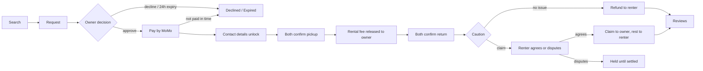
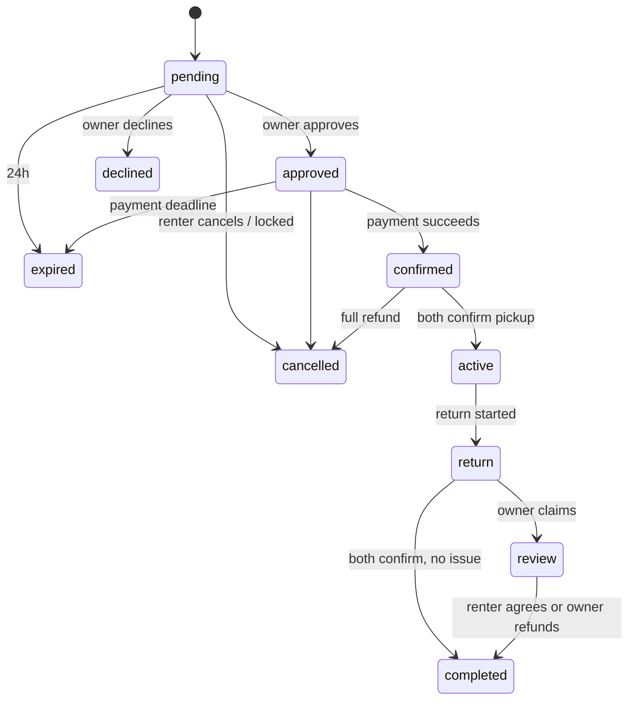
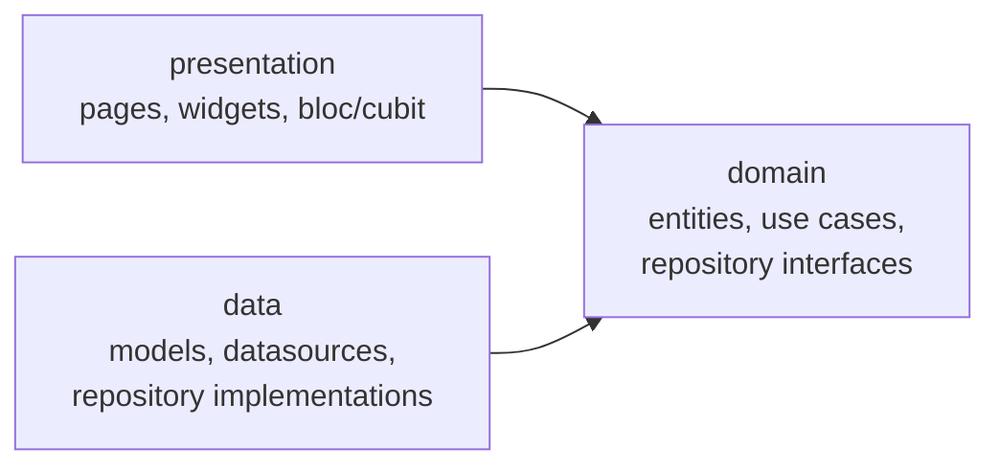
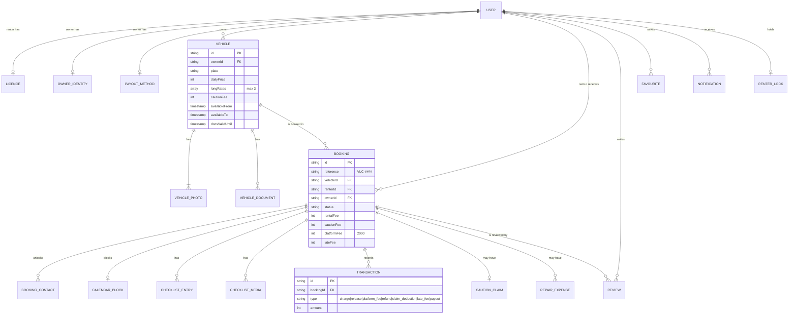

# Veloce Technical Document

Veloce is a Flutter (Android and iOS) peer-to-peer car rental marketplace for Kigali. Car owners
list idle cars, renters request them and pay through MTN Mobile Money, and Veloce holds the money
until both sides confirm handover.

## Links

- GitHub repo: https://github.com/rebakevin/Veloce
- Demo video: `TBD`
- Mock: https://rebakevin.github.io/Veloce/mock.html
- Design system: https://rebakevin.github.io/Veloce/design-system.html

## Contents

1. [Overview](#1-overview)
2. [Technology stack](#2-technology-stack)
3. [System architecture](#3-system-architecture)
4. [Project structure](#4-project-structure)
5. [Layering and dependency rules](#5-layering-and-dependency-rules)
6. [State management](#6-state-management)
7. [Data model](#7-data-model)
8. [Booking and money logic](#8-booking-and-money-logic)
9. [Queries, filters and indexes](#9-queries-filters-and-indexes)
10. [Authentication](#10-authentication)
11. [Security](#11-security)
12. [Photo and file pipeline](#12-photo-and-file-pipeline)
13. [Local preferences](#13-local-preferences)
14. [Error handling and validation](#14-error-handling-and-validation)
15. [UI](#15-ui)
16. [Testing](#16-testing)
17. [Setup and run](#17-setup-and-run)
18. [Methodology](#18-methodology)
19. [Known limitations and future work](#19-known-limitations-and-future-work)
20. [Conclusion](#20-conclusion)
21. [References](#21-references)

---

## 1. Overview

Veloce has two roles. One account holds one role; a person who both rents and owns uses two accounts
and switches between them from the profile.

**Renter**

- Register, log in (email and password, or Google) and reset the password
- Search cars by area and dates, filter, and save favourites
- Request a car, pay by MoMo after approval, confirm pickup and return with photos
- Agree or dispute a caution claim
- Review the owner and the car, and view payment history

**Car owner**

- List a car in a 7-step wizard with documents, long-rental rates and one availability window
- Approve or decline requests, confirm pickup and return, settle or claim the caution fee
- Log repair costs and view finances (total earned and total losses, as a chart or a table)

**Both roles**

- In-app notifications, public reviews, and account switching

### 1.1 Objective

Cars in Kigali sit idle while others need one for a few days. Veloce connects the two and removes
the trust gap. The owner is paid only after both sides confirm pickup, and the renter's caution fee
stays held until the return is settled. Payments, identity checks and Veloce's licence to hold funds
are simulated behind interfaces so a real provider can replace them.

### 1.2 Use cases

| Use case                                      | Renter | Owner |
|-----------------------------------------------|:------:|:-----:|
| Register, log in, switch account              |   ✓    |   ✓   |
| Search, filter, save cars                     |   ✓    |       |
| List and manage cars, availability, documents |        |   ✓   |
| Request a booking                             |   ✓    |       |
| Approve or decline a request                  |        |   ✓   |
| Pay (MoMo, simulated)                         |   ✓    |       |
| Confirm pickup and return (photos required)   |   ✓    |   ✓   |
| Claim the caution fee                         |        |   ✓   |
| Agree or dispute a claim                      |   ✓    |       |
| Log repair costs, view finances               |        |   ✓   |
| View payment history                          |   ✓    |       |
| Review each other and the car                 |   ✓    |   ✓   |

### 1.3 App flow



Either side can cancel with a full refund until both have confirmed pickup.

### 1.4 Booking states



---

## 2. Technology stack

| Concern              | Choice                                                                                 | Notes                                              |
|----------------------|----------------------------------------------------------------------------------------|----------------------------------------------------|
| Framework            | Flutter / Dart, Material                                                               | Android and iOS only; web and desktop are excluded |
| State management     | `flutter_bloc` (Bloc and Cubit), `equatable`                                           | No `setState` for app state                        |
| Dependency injection | `get_it`                                                                               | One `*_injection.dart` per feature                 |
| Routing              | `go_router`                                                                            | Role-based shells and an auth redirect guard       |
| Identity             | `firebase_auth`                                                                        | Email and password, plus Google Sign-In            |
| Database             | `cloud_firestore`                                                                      | Spark plan, rules as the gate                      |
| File storage         | `supabase_flutter` (Storage only)                                                      | Firebase Storage needs the paid plan               |
| Local data           | `shared_preferences`, `flutter_secure_storage`                                         | Preferences; linked-account credentials            |
| Charts and media     | `fl_chart`, `image_picker`, `video_player`                                             | Finances; photo and video capture                  |
| Tests                | `flutter_test`, `bloc_test`, `mocktail`, `fake_cloud_firestore`, `firebase_auth_mocks` |                                                    |

---

## 3. System architecture

| Backend          | Used for                                                          | Why                                                     |
|------------------|-------------------------------------------------------------------|---------------------------------------------------------|
| Firebase Auth    | Identity, email verification, password reset, Google Sign-In      | Assignment requirement                                  |
| Cloud Firestore  | Users, vehicles, bookings, ledger, claims, reviews, notifications | Assignment requirement; live streams; rules as the gate |
| Supabase Storage | Car media, ID and licence photos, checklist media, receipts       | Firebase Storage is not free                            |

**No Cloud Functions.** Every booking and money transition is a client-side Firestore transaction or
batch that the security rules validate with `getAfter()`. Time-based expiry is lazy: it is evaluated
and saved when either party opens the app. The repository interfaces are the seam, so Cloud
Functions can replace the data layer later without touching the UI.

Payments (`MomoGateway`) and identity checks (`VerificationProvider`) are interfaces with simulated
implementations.

---

## 4. Project structure

Feature-first, with the shared contracts in `core`.

```
lib/
  main.dart            # init Firebase, Supabase, DI, runApp
  app/                 # app.dart, router/, di/
  core/                # config, constants, domain, data, error, theme, utils, widgets
  features/
    auth/ profile/ vehicles/ discovery/ booking/
    handover/ finances/ reviews/ notifications/
      data/ domain/ presentation/
      <feature>_injection.dart
      <feature>_routes.dart
test/                  # mirrors lib/
tool/seed/             # Firebase Admin seed script
tool/supabase/         # storage.sql
```

Each feature owns its injection and route files, so two people never edit the same shared file. See
`docs/adr/0001-phase-0-decisions.md` for where the layout differs from the generic conventions.

---

## 5. Layering and dependency rules



| Layer        | Contains                                                             | May import                 | Rules                                          |
|--------------|----------------------------------------------------------------------|----------------------------|------------------------------------------------|
| domain       | Entities, enums, validators, business rules, repository interfaces   | Dart core only             | No Flutter, no SDK                             |
| data         | Repository implementations, models (`fromMap`/`toMap`), SDK adapters | domain, Firebase, Supabase | Only layer that touches the SDKs               |
| presentation | Pages, widgets, blocs                                                | domain, shared `core`      | No cloud imports, no business logic in widgets |

- Repositories return `Result<T>` (`Success` or `Failure(AppFailure)`) and never throw to the UI.
- Blocs are created in route-level `BlocProvider`s, so they are disposed on navigation and on
  sign-out.
- Pages that several phases share use **slots**: small widgets in separate files, each owned by one
  phase (for example `FinancesCard` on `OwnerHomePage`).
- A phase may read any collection through the `core` lookups (`UserLookup`, `VehicleLookup`,
  `BookingLookup`) but writes only its own.

---

## 6. State management

- A screen reads state and calls bloc methods. A bloc calls repositories and turns failures into
  states. A repository is the only thing that talks to a backend.
- States extend `Equatable` and carry `status`, `data` and `error`. Every list shows loading,
  loaded, empty and error. Submit buttons are disabled while a request runs.
- Firestore streams plug into blocs, so the UI updates right after a write.
- Cubit for simple state (theme, filters, favourites toggle). Bloc for multi-step flows (auth,
  listing wizard, booking actions).
- **Sign-out** emits `Unauthenticated`, disposes every route-level bloc and clears local caches.
- `setState` is banned for app state. CI fails on `grep -rn "setState(" lib/`.

| Bloc / Cubit                                                                                   | Phase | Scope             | Purpose                                                   |
|------------------------------------------------------------------------------------------------|-------|-------------------|-----------------------------------------------------------|
| `AuthBloc`                                                                                     | 1     | App root          | `Unknown`, `Authenticated(user, role)`, `Unauthenticated` |
| `LoginBloc`, `RegisterBloc`, `ForgotPasswordCubit`                                             | 1     | Auth screens      | Multi-step registration, login, reset                     |
| `ProfileBloc`, `AccountsBloc`, `SettingsCubit`                                                 | 1     | Profile           | Edit profile, account switcher, theme and notifications   |
| `ThemeCubit`                                                                                   | 0     | App root          | Theme mode                                                |
| `CarWizardBloc`, `MyCarsBloc`                                                                  | 2     | Owner             | Listing wizard, My cars                                   |
| `SearchCubit`, `FiltersCubit`, `ResultsBloc`, `CarDetailBloc`, `FavouritesBloc`, `RequestBloc` | 3     | Renter            | Search, favourites, request                               |
| `ActivityBloc`, `BookingDetailBloc`, `DecisionBloc`, `PaymentBloc`, `ExpirySweeperCubit`       | 4     | Booking           | Decision, payment, expiry                                 |
| `PickupBloc`, `ReturnBloc`, `ClaimBloc`, `RepairExpenseBloc`                                   | 5     | Handover          | Pickup, return, claims                                    |
| `ReviewBloc`, `NotificationsBloc`, `FinancesBloc`                                              | 6     | Reviews, finances | Reviews, notifications, finances                          |

States per bloc: `TBD` (filled in as each phase merges).

---

## 7. Data model

The ERD below is the Firestore design. Field names in `core/constants/firestore_fields.dart` equal
the names here. The full field list is in `docs/resources/ER-DIAGRAM.md`.



### 7.1 Firestore mapping

| Entity                             | Path                                                   | Read by                                         |
|------------------------------------|--------------------------------------------------------|-------------------------------------------------|
| User                               | `users/{uid}`                                          | Any signed-in user (public fields only)         |
| Contact, licence, identity, payout | `users/{uid}/private/{doc}`                            | The owner of the document                       |
| Favourite                          | `users/{uid}/favourites/{vehicleId}`                   | That user                                       |
| Vehicle, photos                    | `vehicles/{id}`, `.../photos/{id}`                     | Any signed-in user                              |
| Vehicle documents                  | `vehicles/{id}/documents/{kind}`                       | The vehicle's owner                             |
| Booking                            | `bookings/{id}`                                        | The two parties                                 |
| Booking contact                    | `bookings/{id}/private/{renter\|owner}`                | The other party, only once `confirmed` or later |
| Checklist entries and media        | `bookings/{id}/checklistEntries`, `.../checklistMedia` | The two parties                                 |
| Calendar block, renter lock        | `calendarBlocks/{id}`, `renterLocks/{renterId}`        | Any signed-in user                              |
| Transaction                        | `transactions/{id}`                                    | The two parties; create-only                    |
| Caution claim                      | `cautionClaims/{bookingId}`                            | The two parties                                 |
| Repair expense                     | `repairExpenses/{id}`                                  | The vehicle's owner                             |
| Review                             | `reviews/{bookingId_authorId_subjectType}`             | Any signed-in user                              |
| Notification                       | `notifications/{id}`                                   | The recipient                                   |
| Audit log                          | `auditLogs/{id}`                                       | Nobody in the app; create-only                  |

### 7.2 Intentional duplicates

Every other value lives in one place. These are the only copies, each needed for access control or
queries.

| Duplicate                                                        | Why                                                                                              |
|------------------------------------------------------------------|--------------------------------------------------------------------------------------------------|
| `ratingAvg`, `ratingCount`, `completedCount` on user and vehicle | Cards need them without scanning reviews; updated in the same batch as the review                |
| `VEHICLE.docsValidUntil`                                         | Search must hide cars with expired papers, but renters cannot read the private documents         |
| `BOOKING_CONTACT`                                                | Rules cannot join, so phone and email sit in a document the other party reads only after payment |
| `CALENDAR_BLOCK`                                                 | Renters cannot read other bookings, yet search must exclude blocked dates                        |
| `TRANSACTION.ownerId/renterId/vehicleId`                         | Finances and payment history query without joining bookings                                      |

---

## 8. Booking and money logic

### 8.1 Pricing

| Item              | Rule                                                                                                                                                                                  |
|-------------------|---------------------------------------------------------------------------------------------------------------------------------------------------------------------------------------|
| Days              | `endDate − startDate`, return day not charged, minimum 1                                                                                                                              |
| Daily rate        | The tier with the largest `fromDays ≤ days`, else the base price; applies to every day                                                                                                |
| Rental fee        | `days × rate`                                                                                                                                                                         |
| Total payable     | `rentalFee + cautionFee` (the renter sees no platform fee)                                                                                                                            |
| Platform fee      | Flat RWF 2,000, paid by the owner from the payout                                                                                                                                     |
| Long-rental tiers | Up to 3, `fromDays ≥ 2`, each price lower than the base and the previous tier, at least RWF 5,000                                                                                     |
| Late fee          | `lateDays = ceil(hoursLate / 24)`; `rentalFee × 1.3^lateDays − rentalFee` (100,000 → 130,000 → 169,000 → 219,700); owner may waive; late fee plus claim never exceeds the caution fee |

The rate and totals are written into the booking at request time and never recomputed.

### 8.2 Ledger (escrow as bookkeeping)

| Type              | From → To           | Written when                            |
|-------------------|---------------------|-----------------------------------------|
| `charge`          | renter → Veloce     | Payment succeeds                        |
| `release`         | Veloce → owner      | Both confirm pickup                     |
| `platform_fee`    | owner → Veloce      | Same moment                             |
| `payout`          | Veloce → owner MoMo | Same moment (`rentalFee − 2,000`)       |
| `refund`          | Veloce → renter     | Cancel, safe return, or claim remainder |
| `claim_deduction` | Veloce → owner      | Claim agreed                            |
| `late_fee`        | Veloce → owner      | Settled out of the caution fee          |

Invariant, unit-tested: `held = charge − release − refund − claim_deduction − late_fee ≥ 0`, and `0`
once the booking is completed or cancelled.

**Worked example.** Rental 50,000 and caution 25,000. The renter pays 75,000. At pickup the owner
receives 48,000 and 25,000 stays held. On a safe return the 25,000 goes back to the renter.

### 8.3 One transaction per transition

Each transition is one Firestore transaction or batch holding the booking update, ledger entries,
calendar and lock changes, notifications and an audit-log entry. The rules check the batch with
`getAfter()`, so the client cannot mark a booking `active` without both confirmations or write a
`release` for the wrong amount.

### 8.4 Cross-user effects without a server

| Rule                                                       | Mechanism                                                                                                                                        |
|------------------------------------------------------------|--------------------------------------------------------------------------------------------------------------------------------------------------|
| Approval declines overlapping pending requests for the car | The approving owner's batch writes `declined` on those bookings                                                                                  |
| Approval cancels all of the renter's other open requests   | The batch creates `renterLocks/{renterId}`; other open bookings get an effective status of `cancelled`, saved when the renter next opens the app |
| One booking at a time                                      | The same lock; it is released on cancel, decline, expiry, or when the rental enters `return`                                                     |
| 24h pending expiry, payment deadline                       | Lazy: `ExpirySweeper` runs on app start, resume and list load                                                                                    |
| Contact hidden until payment                               | Rules let the other party read the contact document only when status is `confirmed`, `active`, `return` or `review`                              |
| Pending review blocks new requests                         | `PendingReviewChecker` is called by the request and approve use cases                                                                            |
| Expired insurance or medical certificate pauses a car      | `docsValidUntil` filter in search                                                                                                                |

---

## 9. Queries, filters and indexes

**Search (renter)**

1. Query `vehicles` with `status == published`, the optional neighbourhood and
   `docsValidUntil >= today`.
2. Filter type, transmission, seats and price on the device, because Firestore allows one range
   field.
3. Keep cars whose `[availableFrom, availableTo]` contains the whole range.
4. Drop cars with a `calendarBlocks` entry that overlaps the range.
5. Never show the viewer's own cars.

**Indexes** (`firestore.indexes.json`). A new query combination needs a new composite index.

| Collection                 | Fields                                              | Used for                      |
|----------------------------|-----------------------------------------------------|-------------------------------|
| `vehicles`                 | `status`, `neighbourhood`, `dailyPrice`             | Search by area, sort by price |
| `vehicles`                 | `status`, `docsValidUntil`                          | Hide expired papers           |
| `bookings`                 | `renterId` or `ownerId`, `createdAt`                | My Activity                   |
| `bookings`                 | `vehicleId`, `status`, `startDate`                  | Overlap checks                |
| `transactions`             | `ownerId`, `at` (and `vehicleId`); `renterId`, `at` | Finances, payment history     |
| `reviews`, `notifications` | `subjectId` / `userId`, `createdAt`                 | Lists                         |

---

## 10. Authentication

| Method             | Detail                                                                                                |
|--------------------|-------------------------------------------------------------------------------------------------------|
| Email and password | Register (role → details → verification → welcome), login, logout, password reset, email verification |
| Google Sign-In     | First sign-in continues to role choice and the document steps; a returning user goes to Home          |
| Simulated OTP      | A 6-digit code shown in a SnackBar for the demo, with a failure mode for the retry state              |

- Unverified users can browse; requesting, publishing a car and paying need a verified email.
- Passwords need 8+ characters with a letter and a digit. `FirebaseAuthException` codes map to plain
  messages.
- `GoRouter.redirect` sends unauthenticated users to `/welcome` and keeps each role in its own
  shell. The session survives a restart.
- **Account switcher.** Linked accounts are kept in `flutter_secure_storage`. Switching signs in the
  target account without a prompt, resets every route-level bloc and opens that account's Home.
  Nothing is shared between accounts.
- **Delete account** removes the user, their cars, bookings, ledger rows, notifications and
  reviews (ADR 0002).

---

## 11. Security

The UI hides what a role may not do, but the Firestore rules are the real gate.

### 11.1 Layers of defence

- Validators and domain guards give instant feedback and run again before each write. They are for
  UX only.
- Firestore rules enforce identity, ownership, field shape and allowed transitions.
- Supabase bucket limits cap file size and type.

### 11.2 How the rules protect user data

| Protection             | How                                                                                                                                                                                     |
|------------------------|-----------------------------------------------------------------------------------------------------------------------------------------------------------------------------------------|
| Default deny           | Every collection is opened explicitly                                                                                                                                                   |
| Ownership              | Private user documents (licence, National ID, payout), favourites and notifications are readable only by their owner; vehicle documents and repair expenses only by the vehicle's owner |
| Parties only           | A booking, its checklists, ledger rows and claims are visible only to its renter and owner                                                                                              |
| Contact lock           | Phone, email and meeting point are readable by the other party only once the status is `confirmed` or later; never on a declined, cancelled or expired request                          |
| Immutable fields       | `role`, rating aggregates and review `authorId` cannot be changed by the client                                                                                                         |
| Valid transitions only | Bookings change only along the §8 table, and money entries must match the booking's amounts (`getAfter`)                                                                                |
| Append-only            | Ledger and audit log cannot be updated; reviews cannot be removed except when the user deletes their account                                                                            |
| Create checks          | A booking must start `pending`, carry a RWF 2,000 platform fee and `total = rentalFee + cautionFee`, and name the vehicle's real owner                                                  |

### 11.3 Supabase and secrets

- Buckets: `car-media` (public read), `user-docs`, `checklist-media`, `receipts` (private paths with
  UUID names).
- Policies allow the anon role only `INSERT` and `SELECT`. Images are capped at 5 MB, videos at 50
  MB, with a MIME allow-list.
- Supabase cannot see Firebase Auth, so sensitive files rely on unguessable UUID paths, and their
  URLs sit only in owner-only Firestore documents. This is an accepted limitation (§19).
- `env.json` is git-ignored and holds only public-by-design values. No service account or admin key
  is in the app or the repository.

---

## 12. Photo and file pipeline

- Photos are picked from the camera or gallery, re-encoded as JPEG (quality 80, longest side 1600
  px) and uploaded through `MediaStorage` to Supabase.
- A car holds 3 to 6 photos and one optional video. Checklists need at least one photo and allow one
  video.
- File names are generated, never taken from user input. A photo that fails to load shows a
  placeholder.
- A replaced file gets a new UUID path; the old one is deleted on a best-effort basis.

---

## 13. Local preferences

| Key                     | Type                  | Restored by                 |
|-------------------------|-----------------------|-----------------------------|
| `theme_mode`            | `system\|light\|dark` | `ThemeCubit`                |
| `notifications_enabled` | bool                  | `NotificationSettingsCubit` |
| `onboarding_seen`       | bool                  | Router splash               |
| `last_search_area`      | string                | `SearchCubit`               |
| `last_type_chip`        | string                | `SearchCubit`               |

---

## 14. Error handling and validation

**Failures.** Adapters turn SDK errors into `NetworkFailure`, `PermissionFailure`,
`ValidationFailure`, `ConflictFailure`, `NotFoundFailure` and `UnknownFailure`. Screens show one
short message per failure through `AppMessenger`; no raw exception text reaches the user. A
permission-denied is usually a lost race, such as a status that already moved.

**Validation.** Each rule is a pure function in `Validators`. The form uses it, the bloc checks it
again, and the rules mirror it.

| Field                | Rule                                                      |
|----------------------|-----------------------------------------------------------|
| Email, password      | Valid format; 8+ characters with a letter and a digit     |
| Phone, MoMo          | `07[2389]xxxxxxx`; MoMo is 9 digits without the leading 0 |
| Date of birth        | 18 or older                                               |
| National ID, licence | 16 digits; licence not expired                            |
| Plate, year          | `RAB 123 A`; 2005–2026                                    |
| Prices               | Daily at least RWF 5,000; caution 0 or more               |
| Rating, reasons      | 1–5; reasons not empty                                    |

A failed submit keeps everything the user typed.

---

## 15. UI

- Mock: https://rebakevin.github.io/Veloce/mock.html
- Design system: https://rebakevin.github.io/Veloce/design-system.html

Both role shells use a bottom bar with Home, My Activity and Profile, a side action (renter: Search
cars; owner: My cars) and a notifications bell.

| Role   | Screens                                                                                                                                                                                     | Screenshot |
|--------|---------------------------------------------------------------------------------------------------------------------------------------------------------------------------------------------|------------|
| Shared | Welcome, login, register steps, forgot password, profile, account switcher, settings, About, Contact                                                                                        | `TBD`      |
| Renter | Home (Explore, Saved), search, filters, results, car detail, request review, My Activity, booking detail, payment, agreement, pickup and return checklists, claim, payment history, reviews | `TBD`      |
| Owner  | Home, My cars, 7-step wizard, availability, documents, request decision, settle caution, repair cost, finances (chart and table), transactions                                              | `TBD`      |

**Standards**

- Works on small and large phones and in landscape with no overflow.
- Text contrast of at least 4.5:1, tap targets of at least 48×48 dp, and semantic labels on icon
  buttons.
- Shared widget kit in `core/widgets` (`PrimaryButton`, `AppTextField`, `PriceBreakdown`,
  `LockedContactTile`, `StatusChip`, `EmptyState` and others).
- Loading, empty and error states on every list, and confirmation dialogs for destructive actions.

---

## 16. Testing

| Level          | Tooling                         | Covers                                                                                   |
|----------------|---------------------------------|------------------------------------------------------------------------------------------|
| Unit           | `flutter_test`, `mocktail`      | Calculators, validators, state machine, use cases, repositories (`fake_cloud_firestore`) |
| Bloc           | `bloc_test`                     | Success, failure and guard cases for each bloc                                           |
| Widget         | `flutter_test`                  | Validation messages, disabled buttons, locked contact tile                               |
| Security rules | Firebase emulator               | Contact lock, append-only ledger (optional)                                              |
| Manual         | Release APK on a physical phone | One scenario log per phase                                                               |

Targets: at least 35 tests and 70% line coverage, with `dart format` and `flutter analyze` clean in
CI.

| Result            | Value |
|-------------------|-------|
| Tests passing     | `TBD` |
| Line coverage     | `TBD` |
| `flutter analyze` | `TBD` |
| Manual test log   | `TBD` |

---

## 17. Setup and run

**Prerequisites:** Git; Flutter SDK (stable, Dart ^3.13); Android Studio with the Android SDK and an
emulator or phone; JDK 17+; `env.json` from the team; access to the Firebase project.

1. Clone the repo and run `flutter pub get`.
2. Put `env.json` in the repo root. `env.example.json` shows the keys (Supabase URL and anon key).
3. Register the debug SHA-1 and SHA-256 fingerprints in Firebase, which Google Sign-In needs.
4. Start an emulator or connect a phone, then run:

```bash
flutter run --dart-define-from-file=env.json
```

5. In a debug build, `/dev-login` signs in as any seeded account (password in
   `docs/test-accounts.md`).
6. Seed data: `tool/seed/seed.js` creates 4 renters, 3 owners, 8 cars and a booking in every status.
   How to run and reset it is in the seed README.
7. Release APK: `flutter build apk --release --dart-define-from-file=env.json`. It needs the team
   keystore and `android/key.properties`, which are not committed.

Tests: `flutter test --coverage`. Checks: `dart format --set-exit-if-changed .` and
`flutter analyze`.

---

## 18. Methodology

- Work is split into seven phases: foundation, authentication, owner cars, renter discovery, booking
  and payment, handover and settlement, and reviews with finances.
- Phase 0 delivers shared contracts, every route and seed data first, so the other phases can build
  in parallel.
- Branches are `phaseN/<feature>`, merged by pull request with one review in a fixed ring, and CI
  must be green.
- CI runs format, analyze, the `setState` grep and the tests.
- Changes to the ERD or core contracts go through a `contract:` pull request that all owners review.

---

## 19. Known limitations and future work

**Limitations**

- Payments, identity and licence verification are simulated.
- There is no server. Expiry runs lazily when a user opens the app, and cross-user effects rely on
  locks and rules.
- Sensitive images rely on unguessable URLs, not authenticated storage.
- The Supabase anon key is in the app, so abuse is limited only by bucket size and type limits.
- Account switching keeps credentials in secure storage on the device.
- Notifications are in-app only, with no chat or admin tooling. Kigali and English only.

**Future work**

- Cloud Functions for transitions and expiry.
- Real MoMo API.
- Supabase row-level security with Firebase third-party auth.
- Push notifications.
- Admin dispute tooling.
- iOS release.

---

## 20. Conclusion

Veloce shows how a trust-based rental marketplace can run on a Flutter client, Firebase and Supabase
with no custom server. A ledger, rule-checked batches and a contact lock keep money and personal
data safe. The simulated payment and verification interfaces mark exactly where real providers would
plug in. Sections marked `TBD` are filled in as phases 2–6 land.

---

## 21. References

[1] Flutter, "Flutter documentation." https://docs.flutter.dev/

[2] Google, "Cloud Firestore." https://firebase.google.com/docs/firestore

[3] Google, "Firebase Security Rules for Cloud
Firestore." https://firebase.google.com/docs/firestore/security/get-started

[4] Google, "Firebase Authentication." https://firebase.google.com/docs/auth

[5] Google, "Unit test your Security Rules with the Firebase Emulator
Suite." https://firebase.google.com/docs/rules/unit-tests

[6] Supabase, "Storage." https://supabase.com/docs/guides/storage

[7] Bloc, "Bloc library documentation." https://bloclibrary.dev/

[8] Flutter, "go_router." https://pub.dev/packages/go_router

[9] fl_chart, "fl_chart." https://pub.dev/packages/fl_chart

[10] Dart, "Effective Dart." https://dart.dev/effective-dart
